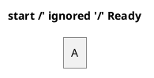
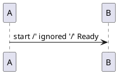

# Task 3J FIX ROUND1 scoped independent re-review

**I1: ADDRESSED. I2: ADDRESSED for the originally reported defect.**

**SPEC: FAIL. QUALITY: FAIL.** One new Important regression, N1, is introduced by the shared substitution-activity change. No Critical finding. The existing Chen keyword-dispatch Minor M1 remains separately deferred and is not reopened here.

## Scope and evidence

Reviewed fix base `35c108daab82b1fa9064ce313ff82a5970d34478` → frozen head `40b949a278fcc2747316c0cfd182b23add4685cb` in `/mnt/data/Projects/ive/.worktree/diagram-ports`.

Read the binding Task 3J brief/global constraints and the complete FIX ROUND1 appendix in `task-3j-report.md`. Read the prepared 13,680-byte `review-35c108d..40b949a.diff` once in two bounded portions. Completed only the cut parser/preprocessor functions and inspected narrowly related lexer arrow recognition, CapabilityScan and authoritative comment-delimiter handling for the named fix risks. No untouched-family survey or regenerated git view.

Controller-supplied fresh evidence is 482 ordinary Rust tests plus seven separately counted actual worker faults, 15 Node tests, all strict gates/audits, unchanged source inventory 220/43/43, four exact original-repro exports and two inspected/hash-verified native captures (2/0 and 1/0). I did not repeat these checks, captures, audits or original-renderer runs. The six genuine RED cases and two preexisting passing controls are clearly distinguished in the appendix; the diagnostic-expectation correction is not presented as a product fix.

Ran only three novel native headless exports for the concrete delimiter-consumption doubt below. No Java/browser/dot/network/GUI launch, product/index/HEAD/progress edits, worktree or subagent. All new review artifacts are under `/tmp`.

## Original findings

### I1 — new declaration keyword breaks existing DESCRIPTION relations from an `archimate` node

**Verdict: ADDRESSED.**

`diagram-ports/engine/src/plantuml/uml.rs:251` now checks lexer-produced **unquoted arrow tokens** before dispatching on the first token's declaration kind. The complete statement then enters the existing relation parser at `uml.rs:433`, which still validates endpoint/role tokens and the entire arrow and preserves scope, ownership and direction. The member-body branch remains ahead of this decision.

This fixes both a preexisting `rectangle archimate` source relation and a genuinely colored ArchiMate node with alias `archimate`, without reserving that alias or special-casing its spelling. The tests assert DESCRIPTION family, actual owner/target IDs and heads, actual fill, and exact quoted arrow-looking display/role/relation text. Quoted arrow text cannot trigger the new guard: `Token.quoted` is checked, and the relation label is already separated using the existing quote-aware colon splitter.

No fix-introduced arrow/declaration breakage found. Unsupported declaration suffixes containing an unquoted arrow still must pass the complete existing relation grammar; the change does not silently discard those tokens.

### I2 — Chen block comments execute literal definitions before Chen strips the comment

**Verdict: ADDRESSED for the originally reported commented-definition/directive defect.**

`diagram-ports/engine/src/plantuml/preprocess.rs:97` now marks the exact Chen wrapper as graph-owned and excludes it from raw-data ownership. Ordinary comment-aware classification therefore precedes definition/directive recognition. A commented definition does not enter the registry; a commented include is inert; active definitions and forbidden active resources retain their existing admission paths. Graph ownership prevents sequence note/action bodies from taking ownership of Chen source.

The new tests check the actual entity identity/text A, inert commented wrapper/function/style tokens, genuine active prefix constants, expanded title/display, stylesheet definition rejection and active resource denial after comments end. The controller's exact four exports also verify both original comment repros produce A and identical SVGs.

The additional `active` gate at `preprocess.rs:291` is intended to prevent replacement inside inline comments while retaining explicit literal definition/raw/quoted ownership. That generalization introduces N1 below; it prevents approval of this fix round even though the originally reported block-comment definitions are now inert.

## New fix-introduced breakage

### N1 — replacement gating can reuse a consumed comment-delimiter byte and suppress an active constant

**Severity: Important; SPEC and QUALITY blocker.**

Locations: the new `active` test at `diagram-ports/engine/src/plantuml/preprocess.rs:291` and replacement gate at `:301`; the reused `CapabilityScan::allows` helper at `:437`, especially `:439`–`:442`.

The helper clears its comment flag at the apostrophe beginning a closing `'/`, but does not consume both delimiter bytes. `expand` advances only one character on that iteration. On the next iteration the closing slash can be combined with a following ordinary literal apostrophe and reinterpreted as a new `/'` opener. The authoritative `source::strip_comments` instead consumes both bytes of the real delimiter and treats the following apostrophe as literal after preceding content.

The helper already had this state-consumption behavior. What this fix newly changes is using that activity state to disable `names.get` replacement: before the fix, replacement was unconditional, so the following active constant expanded despite the helper's phantom comment. This is a concrete new semantic regression from the frozen fix base, not a request to re-review an unrelated family.

Direct Chen reproduction, `/tmp/ive-3j-fix1-review-chen-comment-overlap.puml`:



Command:

```sh
/mnt/data/Projects/ive/target/release/diagram-viewer --language plantuml --render /tmp/ive-3j-fix1-review-chen-comment-overlap.puml --output /tmp/ive-3j-fix1-review-chen-comment-overlap.svg
```

Observed: exit 0, real entity identity/text A, but the emitted title is **`start ' X`**. Expected: **`start ' Ready`**. The actual block comment is closed; X is active source after it. The SVG contains `<text ...>start &apos; X</text>`.

A second minimal input through the same changed shared path, `/tmp/ive-3j-fix1-review-comment-overlap.puml`, uses:



It also exits 0 and emits `start ' X`. The one-space delimiter control `/tmp/ive-3j-fix1-review-comment-separated.puml` instead uses `A -> B : start /' ignored '/ ' X` and emits `start  ' Ready`, confirming the incorrect overlapping-delimiter transition rather than a general disabled-constant rule.

Impact: supported literal constants silently stop expanding in valid shared preamble/label text. Both the new Chen preamble and existing admitted PlantUML behavior are affected. This is semantic text corruption; no external execution, file/network access or resource bypass is asserted.

Required outcome: make comment activity and cursor consumption agree with the ordinary comment grammar so a byte consumed by a delimiter cannot participate in another overlapping delimiter. Preserve original-cursor/no-rescan/origin accounting and explicit quoted/raw/definition ownership. Add meaningful RED/GREEN regressions for an active constant immediately after this closing delimiter plus literal apostrophe, including the direct Chen title case; do not turn a previously admitted input into an unsupported-name policy.

## Other named risks considered

- Unquoted arrows versus quoted display/role text: the lexer-aware guard and complete relation validation are appropriate; no separate finding.
- Normal Chen comments, graph ownership, real prefix stylesheets and active resource denial: the original defect is repaired and the dedicated tests cover the relevant boundaries. N1 is the only new blocker found in this path.
- Quoted labels remain active for substitution; raw note/action/data input and definition-literal targets still short-circuit into their explicit literal policy. Their prior ownership branches and no-rescan insertion mechanism are unchanged. No additional regression established there.
- Budget/origin/cancellation behavior: existing charged scan/append/insert paths remain in use; the fix does not add an unbounded expansion stage or alter measurement/worker APIs. No additional finding.
- No source selections, dependencies, layouts, paint, fixtures or worker services changed. The controller's unchanged audits/captures are accepted as supplied evidence, not duplicate reviewer verification.

## Out-of-scope nonblocking observations

- M1 — Chen keyword-shaped aliases/composite attributes still have the separately deferred dispatch inconsistency. The Chen parser is untouched; no new M1 finding or fix requirement is added by this review.
- No other new out-of-scope observation. Earlier unrelated family Minors and broad final compatibility work remain with their existing ledger entries.

## Disposition

I1 and the original I2 repros are addressed. The scoped fix round remains unapproved because N1 is a newly observable shared semantic regression. Fresh suite/capture success does not cover its delimiter-adjacency case. The controller owns the next scoped fix/re-review, M1 adjudication and any Task 3J/next-family release.
