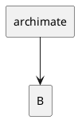

# Task 3J independent SPEC + QUALITY review

SPEC: **FAIL — two Important blockers.**

QUALITY: **FAIL — two Important blockers; one additional Minor finding.** No Critical finding. The substantive Chen model/geometry and colored icon-free DESCRIPTION implementation are present. The gate should remain held for the two boundary defects below.

## Scope and method

Reviewed frozen base `3231bb195bbf183e5e961135f9889a9e872bd611` → head `35c108daab82b1fa9064ce313ff82a5970d34478` in `/mnt/data/Projects/ive/.worktree/diagram-ports`, product `diagram-ports/`. Read the complete binding Task 3J brief, native global constraints, implementation report and canonical `/mnt/data/Projects/ive/progress.md`, including its current frozen/pending gate. Also read the prepared small-family semantic research.

Read the prepared `review-3231bb1..35c108d.diff` in bounded portions; did not regenerate a git diff. Recovered only lines omitted by the initial output truncation. Separately completed the cut UML declaration/dispatch, graph drawing, selection and source declaration-recognition functions where surrounding logic was needed. Focused outside-hunk checks addressed specifically named risks: existing WorkControl error propagation, lexer name/icon admission, Budget accounting, Chen raw-wrapper comment/constant ownership, and the authorized CommandArchimate icon grammar. No unrelated family survey.

Did not rerun suites, audits, captures, original renderers or source/hash checks already freshly handled by the controller. Used the existing native release executable only for seven novel, minimal headless diagnostics tied to concrete code doubts. No Java execution, browser, dot, network, GUI launch, product/index/HEAD/progress edit, subagent or new worktree. Review artifacts are under `/tmp`.

## Important findings

### I1 — new declaration keyword breaks existing DESCRIPTION relations from an `archimate` node

**Severity: Important; SPEC and QUALITY blocker.**

Locations: `diagram-ports/engine/src/plantuml/uml.rs:213` adds the new kind; `uml.rs:252` selects a declaration solely from `kind(first.text)` before trying the relation grammar. The shared family selector and source declaration classifier guard identifier-arrow statements, but this final UML parser does not.

Minimal existing-syntax reproduction, `/tmp/ive-3j-review-description-regression.puml`:



Command:

```sh
/mnt/data/Projects/ive/target/release/diagram-viewer --language plantuml --render /tmp/ive-3j-review-description-regression.puml --output /tmp/ive-3j-review-description-regression.svg
```

Actual: exit 1, `PlantUML at line 4, column 1: "-->"`. The arrow token is being interpreted as the required ArchiMate color. This input uses only the previously admitted rectangle/relation grammar. Before this patch, `archimate` was not a declaration kind and the same parser branch proceeds to relation parsing; the added kind creates the regression. The new declaration `archimate #123456 archimate` followed by a relation from that alias fails identically, independently confirmed with `/tmp/ive-3j-review-archimate-endpoint.puml`.

Impact: a valid existing description node name becomes unusable as a relation source, violating preservation of existing description semantics/precedence. Incoming edges or a standalone sequence message do not exercise this path, so the new passing `archimate -> Other` sequence test does not protect it.

Required outcome: distinguish complete declaration grammar from an authored relation at the UML parser boundary. Preserve both old DESCRIPTION relations from this alias and new ArchiMate declarations, with a regression that remains in the description family. Do not silently reserve a previously valid description alias.

### I2 — Chen block comments execute literal definitions before Chen strips the comment

**Severity: Important; SPEC and QUALITY blocker.**

Locations: `diagram-ports/engine/src/plantuml/preprocess.rs:97` / `:106` adds Chen to `raw_data`. On subsequent lines, `literal_input` bypasses `source::strip_comments` in the classification path near `preprocess.rs:60`; the ordinary definition/directive branches still run. Chen only strips comments later in `source.rs:55`, after expansion has already changed the source.

Minimal reproduction, `/tmp/ive-3j-review-chen-comment-definition.puml`:

```plantuml
@startchen
/'
!define A B
'/
entity A {
}
@endchen
```



Command:

```sh
/mnt/data/Projects/ive/target/release/diagram-viewer --language plantuml --render /tmp/ive-3j-review-chen-comment-definition.puml --output /tmp/ive-3j-review-chen-comment-definition.svg
```

Actual: exit 0. The emitted entity has `data-name="B"` and real painted text `B`; `A` was silently replaced by a definition authored entirely inside an ordinary block comment. A second focused control, `/tmp/ive-3j-review-chen-comment-include.puml`, places `!include inert-comment.puml` in the same comment and exits 1 as an active unsupported directive at line 3.

Impact: the documented normal Chen comment grammar does not own its contents at the preprocessing boundary. Inert comments can alter semantic identity/display, or make an otherwise supported diagram fail. No include or external access executes; this is a lexical/semantic boundary error, not a demonstrated runtime I/O escape.

Required outcome: retain ordinary Chen comment ownership before recognizing definitions/directives and expanding active source. Keep active includes denied and genuinely authored prefix constants supported. Tests should assert both unchanged node identity for a commented definition and acceptance of inert directive-looking comment contents. Ensure the solution also retains normal shared preamble/stylesheet ownership rather than merely deleting the two repro strings.

## Minor finding

### M1 — Chen keyword-shaped aliases/composite attributes have inconsistent dispatch

**Severity: Minor; non-blocking separately from I1/I2.**

Location: `diagram-ports/engine/src/plantuml/chen.rs:109` (inside `Parser::line` at `:100`). Any first word `entity` or `relationship` with any second whitespace-delimited word is treated as a declaration before association/attribute parsing.

`/tmp/ive-3j-review-chen-keyword.puml` declares `entity entity { }`, a relationship `R`, then `entity -1- R` on separate physical rows. Declaration succeeds, but the association exits 1 at line 6: `Chen declaration requires opening owner brace: "entity -1- R"`. These aliases pass the advertised identifier grammar; the parser does not reject them as reserved at declaration time.

The controller identified a directly related composite case, independently confirmed: `/tmp/ive-3j-review-chen-composite-spaced.puml` contains `entity {` as a composite attribute inside entity `C` and rejects it as a nested declaration at line 3. The otherwise identical `/tmp/ive-3j-review-chen-composite-compact.puml` spells it `entity{` and renders successfully, preserving the three nodes. The same predicate covers `relationship`.

Impact: supported identifier/attribute syntax depends on the name and optional whitespace. This is a narrow new-family admission inconsistency, with no demonstrated lost edges in a successful render; it is comparable in scope to the explicitly deferred earlier keyword-dispatch Minors. Recognize an actual entity/relationship declaration shape before applying the nested-declaration rejection, or explicitly define/reject a narrower reserved-name policy consistently. Preserve the requirement that actual nested entity declarations reject.

## Strengths and satisfied contracts

- Chen has dedicated Entity/Relationship/Attribute kinds and distinct typed Entity/Relationship/Attribute owners. Ownership is a lexical stack, not container parenting; composite attributes are separate ovals with real links. Complete owner-qualified keys prevent same-short-name attributes from collapsing. Duplicate identities and unresolved association endpoints fail.
- Chen creates its own checked multigraph, retaining parallel associations, self-links, cycles and disconnected nodes. Undirected scene links contain no head primitives. Matching participation markers are enforced; normal/bold reaches actual 1.5px/2px SVG strokes rather than an invented double line.
- Entity rectangles, 2:1 relationship diamonds and attribute ellipses use distinct measured geometry. The diamond/ellipse dimensions contain measured label rectangles; boundary projection uses the actual L1/ellipse equations. Cardinalities reserve measured Dagre label dimensions and are painted at its label coordinates. Direct tests check real-shape corners, endpoints, route-centered cardinalities and label/node separation at 6/14/96px, including a self-loop.
- ArchiMate is a Kind/Fill extension within DESCRIPTION, with actual safe authored rectangle fills. Hex parsing is shared and finite; the two named fixture colors are exact, traceable constants. Alias and display remain distinct, ordinary authored direction and package parent ownership remain available, and class/description mixing rejects in either declaration order.
- The authorized CommandArchimate grammar has the icon slots described by the brief. Unquoted icon tokens/attached chevrons cannot pass the new command's strict name/identifier grammar at any slot; sprites, openiconic/images, macros/includes, package/multiline forms and the invented wrapper are not silently accepted as icon-free support.
- `graph::layout_checked` preserves the preexisting WorkControl path: a Budget error is retained and returned before generic Dugong error mapping. Existing UML layout calls the same measure/build → checked kernel → draw sequence. No new swallowed cancellation/error path was found.
- `lexer::model_tokens` charges each new Chen token before `next` scans/allocates it, while the existing `tokens` entry keeps Work accounting. The bare-token cap precedes allocation; quoted scanning retains its previous incremental cap. Chen prechecks composite depth/expanded keys and counts real nodes, synthetic ownership links and associations. Conservative existing Budget limits and shared checked scene/output admission remain in use.
- Existing entities receive `Fill::Default` at both construction sites. Only the new command authors a fill; rendering changes its enclosure while retaining the measured label pipeline. The remaining shared Kind consumers use the intended rectangle geometry and ordinary description relations.
- Tests go beyond label/XML checks into semantic IDs, owners, topology, shape equations, true writer limits and cancellation after a real host callback. Viewer tests add genuine native-paint and worker-cache scenarios rather than faking fallback/native counts. No dependency, worker service or public measurement API changes.

## Considered and declined as additional findings

- All five Chen semantic decorations and d/o/U subtype junctions: explicit unsupported errors are permitted by the brief; no false plain-shape implementation is claimed.
- ArchiMate's two-name color subset, deferred package/multiline declarations, absent architecture layers/icons and declaration reopening: explicitly bounded and allowed; the exact named fixture colors genuinely paint.
- Directed Dagre edges used internally for undirected Chen placement: layout orientation alone does not add semantic direction; scene output has no arrowheads.
- Declaration-order numeric IDs: identities are stable within the frozen model and metadata retains the qualified semantic keys. The task does not require stable numeric IDs across arbitrary source edits.
- Native margins, paper backplates, Dagre routing and general collision differences from original pixels: disclosed limitations. The code/tests establish the required revealing geometry cases, not universal Graphviz ordering or pixel parity.
- Generic lexer name/quote normalization and coarse source columns: inherited shared behavior; no separate new substantive semantic loss was established beyond the concrete dispatch findings.
- Larger parser/test functions and conservative budget charging: preferences rather than demonstrated correctness/resource failures. No unrelated refactor requested.
- Other already-deferred timing/Gantt/nwdiag issues, final corpus/export/audit-tool hardening and advanced family compatibility: outside this frozen task. They were not re-reviewed or promoted into new findings.
- Source/capture/test report claims: controller independently matched all 14 added source/JAR/hash/actual-credit/MIT-grant entries, both base fixtures and the two genuine captures, and repeated all full gates. Those are explicit supplied controller facts, not results of duplicate reviewer commands. No contrary evidence in this patch.

## Verification limits and disposition

The seven headless diagnostics above are the only new runtime checks in this review. No full-suite success, native screenshot inspection, original pixel comparison or broad upstream compatibility claim is made independently here. The supplied fresh 474 ordinary Rust tests plus seven separately counted worker faults, 15 Node tests, strict checks/audits and native captures remain useful evidence but do not cover I1/I2.

No extra unverified blocker is asserted. After scoped fixes, re-review the changed dispatch/comment-boundary paths and meaningful RED/GREEN regressions. The controller owns any fix release, Minor adjudication and next-family gate.
