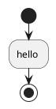

**R1: "wrapper detection runs against the raw row regardless of comment or raw-body ownership, while the existing source parser recognizes wrappers after comment stripping and lets raw note/action bodies own their text. This both rejects valid definitions and skips legitimate substitutions." — ADDRESSED.** `diagram-ports/engine/src/plantuml/preprocess.rs:64` now classifies nonliteral rows through comment normalization; wrapper transitions at lines 82–97 use that classified spelling and exclude raw note/action rows. Exact end markers replace the broad `@end` prefix. The three original reproductions have dedicated regressions (`should_ignore_block_commented_wrappers_before_definitions`, `should_recognize_comment_normalized_opening_wrappers`, `should_expand_wrapper_looking_raw_note_rows`), all recorded passing in the fresh fix log. The separate generated-wrapper regression below does not reopen these specific defects.

**R2: "an activity action’s opening row enters strip_comments before preprocessing has established that it belongs to a raw action. The existing source parser deliberately recognizes a leading : before comment stripping. An apostrophe-block-looking substring in that opening payload therefore changes the preprocessor’s comment state, prevents body detection, and suppresses expansion on following raw rows." — ADDRESSED.** `diagram-ports/engine/src/plantuml/preprocess.rs:58` calls shared raw ownership before comment normalization. `diagram-ports/engine/src/plantuml/source.rs:211` includes the opening `:` row and retains the existing authored note/action terminator rules; `source.rs:142` uses the same helper. The exact opening `:opening /' literal` plus following `' X` reproduction is covered by passing `should_keep_comment_looking_action_openings_raw`; neighboring authored single-line/multiline terminator controls also pass. Expansion-induced termination now has the new defect below.

### New Breakage in the Fix Diff

**Important — A constant-generated action terminator leaves preprocessing in raw ownership and permits a generated closing wrapper.** `diagram-ports/engine/src/plantuml/preprocess.rs:58` now chooses the next action state from the unexpanded opening row. After expansion, `preprocess.rs:137` skips state reconciliation because that same opening row is `raw_text`. If its final constant expands to `;`, final source parsing ends the action, but preprocessing continues treating subsequent syntax as raw. The `!raw_text` guard newly added at `preprocess.rs:128` then bypasses generated-wrapper denial for those subsequent rows.

**Confirmed reproduction:** `/tmp/ive-constants-rereview-generated-end.puml` contains exactly:

**Observed:** the fresh release viewer exports this input successfully (exit 0), producing an activity-start, action `hello `, and activity-stop in `/tmp/ive-constants-rereview-generated-end.svg`. There is no authored closing wrapper; the only closing wrapper is inserted by `END`. This violates the explicit denial of generated wrappers at syntax positions. Before the fix, the opening row reached the post-expansion `text_body` classification, which saw the inserted `;`, so the later `END` was subject to generated-wrapper denial. The new raw-opening path introduces this bypass; this is within the fix diff, not an unchanged-code observation.

**Required correction:** keep the current opening row raw before comment normalization, while reconciling its next ownership state with the expanded row that final source parsing consumes. Add a regression requiring the input above to fail with generated-wrapper admission, alongside a valid generated-`;` action followed by ordinary syntax and an authored closing wrapper.

### Out-of-Scope Observations

**None.** No broad fresh review or unchanged-code issue was added to this gate.

### Checks and Evidence

- **Scope checked:** complete task brief, binding native constraints, original review, full implementation report including FIX ROUND 1, and the prepared three-file `dad6fb70bcd76569de7877ecdac41b63406ee719..50da37e108256003388361c0b5ac5a3da76735ff` diff. The prepared diff was read once; no git command, product/index/HEAD mutation, or subagent was used.
- **Context check:** read only the scan initialization/tail and source-loop/helper context cut off by the prepared diff, to verify eligibility guards, wrapper handling, and post-expansion state updates. The existing final source parser's raw-action handling confirms the generated-`;` ownership mismatch. No broad repository crawl was performed.
- **Reported coverage checked:** `/tmp/ive-plantuml-3d2-fix1.hiErUE/tests.log` records all six added named regressions passing and constants 27/27; suite result lines total 305 Rust tests. The report also records seven worker scenarios, nine audit tests, strict Clippy/fmt/release/deny/source gates, four exact successful reviewer exports, and controller-inspected captures with identical recaptured baseline hashes. Suites and captures were not rerun for this scoped gate.
- **One focused new probe run:** `/mnt/data/Projects/ive/target/release/diagram-viewer --render /tmp/ive-constants-rereview-generated-end.puml --output /tmp/ive-constants-rereview-generated-end.svg` — exit 0; emitted SVG inspected and confirms real activity output. This probe answers the concrete new expansion/ownership doubt absent from the reported tests. It started no GUI or IVE instance and left no viewer process running.
- **Contract scope checked:** the fix adds no dependency, evaluator/resource capability, origin representation, storage-budget change, public render/measurement API change, or paint change. Raw-label resource denial and ordinary generated start/end denial have passing added controls; the new ownership mismatch demonstrates that those controls do not cover an expanded action terminator.

### Verdict

**Fix round: Findings remain open — R1 and R2 are addressed; new Important generated-closing-wrapper bypass must be fixed.**

**SPEC verdict: ❌ Issues found.** The original two classifier defects are corrected, but syntax-position generated-wrapper denial is violated by the fix.

**QUALITY verdict: Needs fixes.** Shared raw-row classification preserves ordinary authored behavior, but its next-state decision on unexpanded opening text diverges from final parsing after a literal constant supplies the terminator.
