# Task 3I independent SPEC + QUALITY review

SPEC verdict: **CHANGES REQUIRED**. QUALITY verdict: **CHANGES REQUIRED**.

One Important blocker, no Critical findings, and no additional Minor findings. The blocker is silent HCL admission of unsupported document/style prefixes. The four-family checkpoint should wait for a scoped repair and independent re-review.

## Scope and evidence

Reviewed frozen base `85887fa1989aa9f21834b8118cddd5735d1dac0a` through head `1bf1f46c762d9ff4a5082aa688c6bff3dfaf2c7a`, using the prepared 3,569-line `review-85887fa..1bf1f46.diff`. Read the complete Task 3I brief, native global constraints and Task 3I report, plus canonical `/mnt/data/Projects/ive/progress.md`. Used the current code-review template. Reviewed all 29 changed files in bounded diff portions. Recovered the unseen initial diff portion after a combined tool response was truncated; did not regenerate git views.

Outside-diff inspection was confined to named risks: raw preprocessor/source ownership and definition ordering, shared budget/cancellation enforcement, and whether cloned packet labels duplicate retained strings. The last risk is resolved by `Label.lines: Arc<[MeasuredLine]>`; fragment labels share measured content. No product/index/HEAD changes, new worktrees or subagents. Only temporary diagnostic/report files were written.

Did not repeat the full suites, audits, captures, reference oracles, or source/JAR matching. The implementer's 450 ordinary Rust tests, seven separately counted actual worker faults, fourteen Node tests, strict checks and release evidence, and the controller's source/capture matching are supplied evidence, not checks independently rerun by this reviewer. The only executed diagnostics were focused novel HCL headless exports for the concrete issue below and its valid-name control. No Java/browser/dot/network was used. Tool execution required the scoped escalation for the known bwrap RTM_NEWADDR initialization failure; no approval rejection occurred.

## Strengths

- Files has a genuine ordered arena/trie: numeric parents, sibling folder reuse without merging files, duplicate final files, literal dot/dotdot and component spaces, root/folder note anchors, and iterative preorder. Notes reserve their complete measured height; native symbols introduce neither external assets nor invented connectors.
- Packetdiag keeps inclusive source fields separate from generated fragments. The width-conserving `5/8/7` split, declaration-width placement, common measured bit scale, aligned ticks, RTL reversal and maximum-height row clearance are implemented directly and tested through identities and geometry. Admitted configuration changes actual layout. Unsupported rotation and malformed attributes reject.
- Board has explicit activity/card identities and nearest-lower-stage ancestry. Its iterative DFS column assignment places later siblings after prior subtrees and later activities after full branch width. Empty stage rows survive, dashed boundaries are real shapes, roots paint once, and labels determine safe card pitches.
- HCL has its own ordered string/object/array model, preserves duplicate field rows, rejects duplicate topblocks explicitly, transfers ownership into ordered data without cloning child ASTs, and uses genuine owning-row compartments/links. Scalar strings, backslash semantics and the non-evaluation boundary are documented and covered.
- Raw-family dispatch and HCL-specific preamble ownership are narrow integrations. Existing public APIs, dependencies, worker protocol and runtime I/O boundaries are unchanged. Source/fixture traces and exact contributor notices are explicit; the new audit allowlist remains selective.
- Parsing, repeated lookups, fragments, ticks, layout visits and metadata generally use the shared budget before retention/work. Cancellation tests cover the first real host callback in all four families. Existing finite scene checks, bounded writer and terminal SVG admission remain on the render path. Native paint tests check actual ink against owning shapes rather than merely searching SVG text.

## Important blocker

### I1 — HCL block-name accumulation consumes unsupported prefix statements across physical lines

**Location:** `diagram-ports/engine/src/plantuml/hcl.rs:49` (block-name loop calling `peek()`/`string()` until `{`; `peek()` skips all whitespace, including newlines). Single-block lowering then intentionally discards the accumulated name.

**Reproduction, title form:**



**Independent style form:**

```plantuml
@starthcl
skinparam defaultFontSize 96
service { x = 1 }
@endhcl
```


Both were exported with the existing release executable:

```sh
/mnt/data/Projects/ive/target/release/diagram-viewer --language plantuml \
  --render /tmp/ive-3i-review-hcl-title.puml \
  --output /tmp/ive-3i-review-hcl-title.svg
```

The same command with `style` substituted also exits 0. Parsed SVG text in each is only `x`, `1`, both at font-size 14. Neither an error nor the authored prefix survives. A combined title+style reproduction also exports only that data object. Temporary inputs/outputs are `/tmp/ive-3i-review-hcl-{title,style,prefix}.{puml,svg}`.

**Cause:** the name reader accumulates `title Unsupported chrome service` (or `skinparam defaultFontSize 96 service`) as one topblock name. Since there is one block, unwrapping removes the name and silently hides the unsupported statement. The HCL preamble bypass correctly gives the body to HCL, but its grammar does not enforce the promised statement boundary.

**Impact and severity:** Important, blocking both SPEC and QUALITY approval. Ordinary mixed input succeeds while discarding an unsupported substantive command, contradicting the explicit strict-admission contract and misleading callers about what was rendered. This is semantic data loss/admission failure; it is not an execution or resource-loading vulnerability.

**Requirement:** the Task 3I HCL subset requires complete consumption and explicit failure for unsupported substantive input. The binding global constraints forbid catch-all stripping/discarded semantics. The report/README specifically claim shared style/chrome prefixes reject and physical lines remain separators.

**Repair direction:** distinguish legitimate HCL block headers from separate unsupported prefix statements, preserving meaningful physical-line boundaries. Do not simply ban the words `title` or `footer`: they are valid block names. Add independent regressions for title-only and style-only prefixes, with the valid-name control below retained. Controller owns implementation and re-review.

**Exact valid-name control:** `/tmp/ive-3i-review-hcl-command-names.puml` contains:

```plantuml
@starthcl
title "named block" { x = 1 }
footer { y = 2 }
@endhcl
```



It exports successfully (exit 0) and retains `title "named block"`, `footer`, and the x/y data compartments. This agrees with the existing command-named-block regression and demonstrates why rejection must be grammar-aware. All focused diagnostics exercise this one risk; no unrelated suites were rerun.

## Minor findings

None added. The existing timing reserved-name, Gantt trailing-comment, nwdiag keyword/whitespace and coarse-diagnostic follow-ups in canonical progress remain owned by their existing gates. Long parser/layout functions exceed the preferred statement count, but their separated grammar/model/layout responsibilities do not establish another actionable correctness or maintainability blocker here.

## Cannot independently verify

- This review does not independently establish the reported full-suite results, actual native capture pixels/hashes, exact source/JAR matching or final process cleanup; those are implementer/controller evidence and were deliberately not duplicated.
- No whole-branch compatibility, original pixel parity, macOS enforcement or non-Unix resource enforcement verdict is provided. The report explicitly does not claim those properties, and none is established by this checkpoint.

## Considered and declined to judge

- Exact original PlantUML symbols/themes/coordinates, repeated packet scales, continuation markers and rotation paint: outside the admitted native subset; the changes disclose deviations or reject unsupported syntax rather than claim parity.
- Broader HCL/Terraform grammar, execution, heredocs, functions, nested/bare arrays, shared HCL styles/chrome and duplicate-topblock replacement: explicit exclusions/rejection policy are allowed for this checkpoint. I1 separately judges failure to enforce that rejection policy.
- File path normalization/filesystem lookup, board arrows/Kanban semantics and other new inventory families: expressly outside scope; the implementation preserves literal paths and the requested native board model.
- Unrelated previously recorded timing/Gantt/nwdiag/coarse-column issues and final corpus/audit-hardening backlog: canonical progress assigns these to later triage; no changed behavior here justifies reopening them in Task 3I.
- Cross-platform font equivalence, arbitrary route collision avoidance and whole-render host hard deadlines: inherited documented limits, without new claims or changed boundaries in this diff.

No other behavior was considered and silently set aside. Candidate concerns about packet label cloning, geometry finiteness, file lookup work and callback cancellation were assessed against the shared implementation and resolved rather than declined.

## Assessment

**Ready for the next family gate: No, with one scoped fix.** Files, packetdiag and board satisfy their checkpoint contracts on reviewed code/evidence. HCL's typed semantics and ownership are sound for admitted values, but header parsing still swallows separate unsupported statements. Repair I1, preserve legitimate command-named blocks, and independently re-review that repair before releasing Chen/icon-free ArchiMate.
