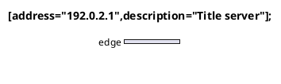

# Independent Task 3H nwdiag SPEC + QUALITY review

Review date: 2026-10-23.

Reviewed only `f6fa5d9a11a558212afb6b910e3358e97374ef5d..85887fa1989aa9f21834b8118cddd5735d1dac0a` in `/mnt/data/Projects/ive/.worktree/diagram-ports`; standalone workspace `diagram-ports/`. Read-only review; no product/progress changes, fixes, branch operations, or subagents. HEAD was independently observed as `85887fa1989aa9f21834b8118cddd5735d1dac0a` and `git status --short` was empty.

## Verdicts

- **SPEC: APPROVED for the bounded Task 3H checkpoint, with the Minor admission exception M1 below explicitly recorded.** The required global identity, per-network address ownership, repeat-update, group, sparse bus/crossing, measured label, resource-bound and safe terminal-output contracts are implemented. This is not approval of full upstream grammar, layout, theme, or pixel parity.
- **QUALITY: APPROVED with Minor M1 deferred.** No Critical or Important blocker found in the reviewed change. The shared typed `Paint::Color(Color)` change remains a finite numeric-color serialization path and preserves existing paint values.
- **Critical blockers: none. Important blockers: none. Minor deferred: M1.** Controller owns adjudication and the next-family release.

## Finding M1 — Minor: whitespace before properties incorrectly reserves chrome-shaped server names

Location: `diagram-ports/engine/src/plantuml/nwdiag.rs:142` (whole-physical-line preamble rejection in `tokenize`). Related existing helper: `engine/src/plantuml/style.rs:225`; `region_command` at line233 recognizes a leading `title`, `legend`, `header`, or `footer` independently of the remaining server grammar. The latter shared file is context for this changed call site, not a separate reviewed change.

The new tokenizer asks `style::is_preamble` about the entire body line before parsing its server name and property list. Consequently the valid membership statement

```plantuml
title [address="192.0.2.1",description="Title server"];
```

fails as a late document-title request. Removing only the single space before `[` makes exactly the same name/properties render successfully:

```plantuml
title[address="192.0.2.1",description="Title server"];
```

Complete failing source is preserved in `/tmp/ive-nwdiag-review-keyword-spaced.puml`:



The passing one-space control is `/tmp/ive-nwdiag-review-keyword-compact.puml`. A separate genuine late-command control, `/tmp/ive-nwdiag-review-keyword-late-chrome.puml`, contains `a;` followed by `title: Actual late title` and correctly fails.

Fresh focused diagnostic using the already-built native exporter:

```sh
/mnt/data/Projects/ive/target/release/diagram-viewer --language plantuml --render /tmp/ive-nwdiag-review-keyword-spaced.puml --output /tmp/ive-nwdiag-review-keyword-spaced.svg
/mnt/data/Projects/ive/target/release/diagram-viewer --language plantuml --render /tmp/ive-nwdiag-review-keyword-compact.puml --output /tmp/ive-nwdiag-review-keyword-compact.svg
/mnt/data/Projects/ive/target/release/diagram-viewer --language plantuml --render /tmp/ive-nwdiag-review-keyword-late-chrome.puml --output /tmp/ive-nwdiag-review-keyword-late-chrome.svg
```

Observed exits respectively **1, 0, 1**. The first error is:

```text
diagram-viewer: diagram worker: unsupported diagram feature: PlantUML at line 4, column 1: "nwdiag styles/chrome must precede the body: \"title [address=\\\"192.0.2.1\\\",description=\\\"Title server\\\"];\""
```

The successful control SVG contains `data-kind="nwdiag-server"`, `data-name="title"`, and interface `data-name="192.0.2.1"`. Thus this is a declaration-versus-command boundary defect, not an unsupported property, unsupported identifier character, missing wrapper, or failure of the engine itself to represent that server.

Spec basis: the brief requires source-verified identifier grammar and fully consumed properties; README line134 admits global server names made of Unicode letters/numbers or `-._` without reserving document-command words. The selected authorized MIT `nwdiag/CommandElement.java:138` admits these names, and line139 explicitly permits zero or more spaces before the optional bracket definition. No JVM/oracle was run to establish this; this is direct grammar evidence from the authorized file plus the native one-space differential.

Why Minor: the source fails explicitly and retains no incorrect topology/output; compact spelling provides a local workaround. It does not undermine stable identities, membership ownership, bounds, or security. Nevertheless it contradicts the documented whitespace/name contract and should remain a concrete follow-up. The repair should distinguish a complete valid nwdiag server statement before rejecting genuine late document commands, retaining the current late-command negative controls. This report does not prescribe reopening other families or broadening their keyword policy.

## SPEC evidence checked

Read `/mnt/data/Projects/ive/progress.md`, complete Task3H brief, `native-global-constraints.md`, Task3H report, Task7 extract and specialized-semantics material. Read the supplied `review-f6fa5d9..85887fa.diff` once; where displayed diff content was truncated, inspected the actual touched parser/layout/tests/shared files directly instead of regenerating or rereading the diff. Used systematic-debugging for the concrete M1 hypothesis and verification-before-completion to distinguish fresh diagnostics from supplied verification.

- **Identity and ownership:** distinct `NetworkId`, `ServerId`, `GroupId` index source-ordered model vectors; parser registries use identity names. `connect` keys by `(NetworkId, ServerId)`, updates only nonempty repeated addresses, and preserves existing addresses on omitted/empty repeats. Server description/fill are global; network CIDR/display remain separate. Painting iterates the server vector exactly once and emits actual membership owner/target IDs.
- **Groups:** ownership is separate from network membership. Top-level groups must reference existing global servers and do not add a network; network-scoped groups add both associations. Assignment rejects repeat/multiple grouping. Group headers use description, not identity name. Column reordering keeps group members contiguous while model IDs and declaration order remain stable.
- **Grammar:** exact wrapper dispatch and balanced canonical body, complete bracket key/value/comma consumption, duplicate-list-key checks, whole-input termination, nonnested networks/groups, explicit unsupported shapes/widths/colors/links/hidden networks and resource constructs are present. M1 is the specific exception to the claimed identifier admission. Documented narrower policies for named declarations, single-line quoted/single-atom values and exact hex fills are honest.
- **Topology and geometry:** buses have sparse member-index vectors and cables have per-membership lanes. The ordered active-cable sweep cuts gaps for earlier foreign cables crossing the interior of later buses instead of adding junction dots; membership junction dots occur at owning-bus route origins. The skipped-intermediate-network case has direct model/geometry coverage. Server/interface widths, bus labels/CIDRs, group-header width/height and group bounds feed placement. Group elements are painted before buses/cables/servers. Local route fan-in lies below the reserved group-header band.
- **Bounds and cancellation:** token/property/model/group items and retained text are charged before retention; network/group nesting is checked before block insertion. Layout measurement, ordering, membership iteration, sweep visits/segments and generated primitives are charged. Storage is sparse, with no networks-by-servers allocation. Dense crossing work can be quadratic, but visits are charged and cancellation checked through the shared budget. Existing Context host checks, finite scene checks, bounded SVG writer, and terminal resvg/resource validation remain in the render path.
- **Styles/color/shared scope:** shared preamble fonts/chrome/constants reach the same measured Context and scene paint path. Hex fills use a parsed numeric Color rather than an arbitrary SVG/CSS string. Existing Paint values serialize to their previous literals. No runtime filesystem/network/environment/clock/process/browser/dot or new dependency path was introduced by this increment.
- **Tests, integration and provenance:** read the sixteen public nwdiag tests and seven direct model/geometry/bounds tests; they assert exact IDs/owner-target relations, updates, group separation/containment, sparse storage, real crossing intervals, custom bounds and inflight callback cancellation. Read the native paint/worker-lifetime/example additions, authored example and scoped manifest/notices/audit-admission mappings. The controller had already independently matched the ten exact source/JAR hashes and credits; I did not repeat those matches or source audits.

## Verification limits

Per controller instruction, did **not** rerun the supplied full suites, audits, captures, or original oracles. The implementer/controller evidence supplied for the gate is 413 Rust tests plus seven separately counted actual worker-fault scenarios, thirteen Node tests, strict fmt/Clippy/release/deny/source audits, and a genuinely inspected capture reporting 21 native measurements/zero deterministic fallbacks. Those remain attributed supplied evidence, not newly executed reviewer results.

My only runtime work was the three novel headless native exporter probes for M1. No GUI, IVE instance, Java/browser/dot/network renderer, or persistent test process was started. No product files were edited. The review does not establish general cross-platform font equivalence, full upstream admission, general collision avoidance, or pixel parity beyond the checkpoint's documented claims.
