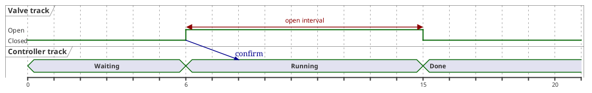
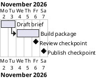
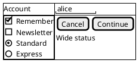
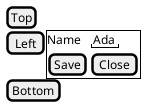
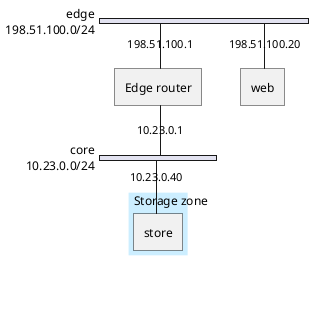

# Specialized PlantUML semantics for native Task 7

Prepared 2026-10-23. Read-only research for `/mnt/data/Projects/ive/.worktree/diagram-ports`; no product edits, native implementation or current-core review. README.md, AGENTS.md and the full 2026-10-23 native plan were read. The Task 3A report was consulted only to identify reusable Budget, Context/Label, Scene and terminal-SVG contracts.

The four initial useful subsets are feasible as separate models and layouts. Timing needs a common numeric axis and state lanes; Gantt needs validated civil dates and schedule constraints; Salt needs a nested widget/table tree; nwdiag needs one global server registry and a separate network-membership relation. Sharing text measurement and scene primitives is useful; representing all four as generic labeled boxes loses their meaning.

## Scope and verified provenance

Only `/mnt/data/Projects/plantuml-mit/src/net/sourceforge/plantuml/` was used for PlantUML grammar/model/layout research. No GPL repository, rejected candidate, alternate edition, `gen/`, `h/`, `smetana/`, external layout translation, stdlib/theme/icon/font/sprite asset or untraced asset was consulted or imported. The generated MIT-edition files themselves retain an older upstream GPL-comment header beneath the MIT grant. That is recorded here without concealing the actual edition/header history.

Source artifact: `/mnt/data/Projects/plantuml-mit/plantuml-mit-1.2026.9-sources.jar`, local SHA256 `88e30e43639555a6963c270bc6245906b81e8cc65140645f416795d0e0bc71c3`. All 65 source files in the appendix were independently hashed and byte-compared to their exact `net/sourceforge/plantuml/…` source-JAR entries. All match. This establishes local artifact identity, not authenticated Maven publication.

Original development oracle: verified MIT 1.2026.9 / 18d0aae jar `/tmp/ive-diagram-oracles.JwN5H5/plantuml-mit-1.2026.9.jar`, SHA256 `e84e45b37ad3030cf802e7be18a687d209eca55733a5679b1f1f1a515f7f70dd`. Each probe checks that hash first. Java uses headless mode, SANDBOX security profile, UTF-8, Liberation Sans, SVG/stdin/stdout, a 20-second timeout and an 8-MiB output bound. The engine design remains pure native, caller-memory-only, with no Java/dot/browser/process/filesystem/network/environment/ambient-clock access.

Existing references `/tmp/ive-plantuml-native-oracles/` and `/tmp/ive-plantuml-native-oracles-report.md` were read and left unchanged. Fresh independently authored examples and original outputs are in `/tmp/ive-plantuml-specialized-probes.Kf1afs/`; the earlier nine-case probe remains in `/tmp/ive-plantuml-specialized-probes.aJWlmI/`. Reproducer: `node /tmp/ive-plantuml-specialized-probes.mjs` creates a new temporary output directory every run. It never writes into the preexisting reference directory.

All twelve fresh outputs exited zero without stderr, passed `xmllint --nonet --noout`, have matching source/SVG hashes and finite positive viewBoxes, nonempty shape geometry, and no external href or foreignObject. These checks do not establish native acceptance, pixels, browser content bounds, actual resolved fonts, complete topology or parity. Eleven cases demonstrate the intended structure. One intentionally retained discovery case, `salt-border-layout`, paints its intended border-position commands as ordinary text; it is explicitly not evidence of border-layout support.

## 1. Timing: numeric axis, state tracks, constraints and messages

### Exact source rules and useful admission

Timing belongs inside `@startuml … @enduml`, not an invented `@starttiming` wrapper. TimingDiagramFactory.java:158–181 registers its own grammar.

| Construct | Initial grammar | Exact source evidence |
| --- | --- | --- |
| Track | `robust ["display" as] CODE` or `concise ["display" as] CODE` | command/CommandRobustConcise.java:144–162, 214–219 |
| Absolute/relative global time | `@NUMBER`, `@+NUMBER`; optional `as :NAME` | CommandAtTime.java:136–147; TimeTickBuilder.java:126–186 |
| Current lane | `@PLAYER` | CommandAtPlayer.java:135–159 |
| State at global current time | `PLAYER is STATE` | CommandChangeStateByPlayerCode.java:140–187 |
| State on current lane | `TIME is STATE` (time has no leading @) | CommandChangeStateByTime.java:140–190 |
| State atom | quoted `"any state"` or code `[-letter/digit/_][-letter/digit/_.]*` | CommandChangeState.java:133, 174–182 |
| Same-lane interval constraint | `[PLAYER]@TIME <-> @TIME [: text]` | CommandConstraint.java:143–162, 192–219 |
| Time message | `PLAYER[@TIME] -> PLAYER[@TIME] [: text]` | CommandTimeMessage.java:133–162, 194–208 |

For a simple interoperable starting subset, use player codes matching the message grammar: initial Unicode letter or underscore, then letters/numbers/underscore/dot. The declaration grammar is broader (`[%pLN_.@]+`), so a declaration such as a digit-first code may not be usable by every other timing command. Either implement those exact distinctions or explicitly reject the broader declarations initially; do not claim a single universal upstream identifier grammar.

Numeric source grammar is `(\+?)(-?\d+\.?\d*)`; absolute negative numbers and positive or negative relative offsets are possible. Upstream uses BigDecimal; preserve exact equality/order and bounded decimal scale if admitting decimals. A native integer-only initial subset may reject fractional values explicitly. Do not parse arbitrary-length decimals into f64 before admission and then merge times because of rounding. Upstream treats an initial relative mark with no current time as that numeric value; requiring an initial absolute mark would be an explicit narrower policy.

Named time syntax is `@0 as :origin` and `@:origin+5`; the colon belongs to the time-code expression. Source also supports clock multiplication, slash dates, HH:MM:SS and format commands. Those can remain unsupported independently of ordinary numeric time. Named time aliases are useful but are not required to obtain a substantive first numeric slice.

The per-render parser has two independent cursors: current time and current player. Declaring robust/concise selects the last player (TimingDiagram.java:365–379). `@P` changes only the current player; it does not reset the current global time. A numeric global mark or lane-local numeric change updates current time and the ruler (TimingDiagram.java:422–435; CommandChangeStateByTime.java:188–190). A state by explicit player reads the current time and does not change it. Before a time is selected, such a state becomes the lane's special initial state (AbstractStatePlayer.java:147–156), rather than a transition at zero.

Two relative-time rules must stay distinct:

- Constraint: resolve the first endpoint against current time, temporarily make that first endpoint current, resolve the second, then restore current time (CommandConstraint.java:205–212). With current time 15, `V@6 <-> @+9` means 6 through 15, not 6 through 24. It does not advance the parser cursor.
- Message: resolve both optional endpoint times independently against the same diagram current time (CommandTimeMessage.java:205–207). With current time 15, `V@6 -> C@+9` means 6 through 24. No endpoint time means current time. Neither command itself adds these endpoints to the ruler's significant-time set; an initial native implementation should require endpoints within the admitted axis range or document a deliberate axis-expansion deviation.

Changes are stored per lane in a TreeSet ordered only by timestamp (AbstractStatePlayer.java:127; ChangeState.java:141–143). At equal numeric times the first inserted change survives; two different lanes may change at the same time. Repeated initial states overwrite the previous initial state. Duplicate declarations and time-code definitions replace entries in their respective maps upstream. A smaller native policy may reject these reopening/redefinition constructs explicitly, but must not silently implement last-wins timed changes.

### Dedicated frozen model and native layout

A useful model is `Timing { tracks, time_marks, constraints, messages }`, with stable TrackId, TimeId and event IDs; `TrackKind::Robust | Concise`; per-track initial-state enum and sorted state transitions; constraints owning one TrackId; messages owning two (TrackId,time) endpoints. Use enum states such as `InitialState::Absent | Present(StateId)`, not optional wrapper fields. Capture numeric times and aliases during bounded parsing; freeze before layout.

Use one measured horizontal time projection for every lane. Robust renders a stepped horizontal signal at distinct labeled state levels, with vertical transitions at exact time x values. PanelsRobust.java:145–211, 246–276 and 296 onward show these semantics. Concise renders a state ribbon segmented by time, with tapered/hexagonal transitions and labels inside the intervals (PanelsConcise.java:121–143; PanelsState.java:185–196, 292 onward). A set of disjoint text boxes is insufficient for either.

The original axis is linear: x(t) = (t − min_time) / tick_unit × pixels_per_tick (TimingRuler.java:242–248). Its GCD/long-based automatic-tick policy can truncate fractional values and differs from decimal state coordinates. The decimal probe visibly paints -2/1 tick labels for -2.5/1.25 changes. Preserve mathematical monotonicity with an original bounded tick selector rather than translating truncation/zero-divisor pitfalls as a parity requirement; record any tick-label difference.

Measure track titles, robust state labels, concise interval labels and constraint captions before placement. A constraint is a measured double-headed dimension arrow with its own vertical reservation, not a schedule constraint (TimeConstraint.java:180–199, 225–228). Messages anchor to the owning lane at each endpoint time; a robust endpoint at a state transition has two possible state-side projections upstream (PanelsRobust.java:152–200); concise endpoints distinguish exact transition and interval boundary projections (PanelsState.java:153–164). Initially reject ambiguous special-state endpoints or document one deterministic state-side policy rather than dropping a message as upstream can do when projection is unavailable (TimingDiagram.java:308–325).

### Valid freshly verified example



Expected topology: two ordered tracks; V states at 0/6/15, C states at 0/6/15; constraint owned by V from 6 to 15; a V@6 → C@8 message; common axis ending at explicit 20. `timing-lane-mode` separately verifies `@V`, bare time changes and cumulative +5/+10 yielding 0/5/15. `timing-named-mark` verifies colon aliases; `timing-labels-decimal` verifies genuine decimal coordinate syntax but exposes original tick-label truncation.

### Tests and rejection boundary

Implement `should_share_one_monotonic_time_projection_across_tracks`, `should_resolve_constraint_end_relative_to_constraint_start`, `should_resolve_message_offsets_from_current_time`, `should_keep_player_cursor_separate_from_time_cursor`, `should_keep_first_change_at_equal_numeric_time`, `should_draw_distinct_robust_steps_and_concise_ribbons`, `should_reserve_measured_constraint_caption_height`, and `should_attach_message_endpoints_to_their_tracks`. Assert exact model identities/times and geometry, not only painted words.

Reject unknown tracks/time aliases, invalid numbers, unsupported scales/ticks/date formatting, clock/analog/binary/rectangle tracks until actual waveforms exist, compact mode until layout exists, state-definition aliases until implemented, hidden/unknown/tristate/multistate forms (`{hidden}`, `{...}`, `{-}`, `{?}`, `{a,b}`) until their actual rendering exists, notes/highlights and styles until emitted. A quoted literal that spells a reserved special-state token still needs an explicit policy because the source renderer recognizes the final string.

Bound numeric token length/scale, significant marks, state count, constraints/messages, axis ticks and label measurements before allocation. Use checked differences and decimal scaling; an enormous +offset must fail before geometry conversion. Charge sorting and state-at-time lookup; use binary search for message projections instead of unchecked O(messages × transitions). Do not enumerate every integer between sparse time marks. Reserve at most a bounded number of generated ticks and check the shared coordinate ceiling.

## 2. Gantt: dated tasks, aliases, duration, precedence and milestones

### Initial source subset

Require a deterministic explicit project date before any task: `Project starts YYYY-MM-DD`. The grammar also accepts `gantt` as project subject (SubjectGantt.java:136–150); no ambient today is necessary. GanttDiagram.java:408–413 rejects setting the project starting point after task definition. Task construction defaults to project start and a one-day load (GanttDiagram.java:343–361; TaskImpl.java:168–176).

```
task-subject := "[" nonempty-display "]" [ "as" "[" alias "]" ]
duration     := task-subject ("lasts" | "requires") positive-integer ("day" | "days")
start-date   := task-subject "starts" ["on" | "at"] YYYY-MM-DD
start-link   := task-subject "starts" ["at" | "after" | "with"] "[" id "]'s" ("start" | "end")
offset-link  := task-subject "starts" N ("day" | "days") ("before" | "after") "[" id "]'s" ("start" | "end")
milestone    := task-subject "happens" ["on" | "at"] (YYYY-MM-DD | link-complement)
```

This deliberately narrows source natural language, not an exhaustive upstream grammar. Actual task subject supports `then`, `it`, stereotypes and resources; exclude them until their ordered semantics exist (SubjectTask.java:489–553). Source duration supports hours/minutes/seconds/days/weeks/months and mixed units (ComplementDuration.java:129–200); `lasts` and `requires` are synonyms (Verbs.java:144). Weeks use open days per week; months use Gantt's configured calendar approximation, not a civil-calendar month. Day-only initial admission avoids pretending those are simple integer-day synonyms. Default calendar has all seven days open (OpenClose.java:156–169); do not close weekends implicitly.

Display and identity are separate. `[Draft brief] as [draft]` registers id `draft`, display `Draft brief`; subsequent `[draft]` refers to that task. TaskCode equality/hash use id only (TaskCode.java:119–144). A later lookup by the visible display is not automatically a lookup by its alias. Complement references must already exist or upstream returns `No such task …` (AbstractComplementTaskInstant.java:123–129). Retain row creation order separately from dependency order.

Date grammar accepts three broader forms, including numeric year/month/day separated by non-digits, while validation uses LocalDate.of (DayPattern.java:145–181; TimeResolution.java:134–143). Native initial ISO-only admission must validate real month/day/leap-year combinations and document the narrower syntax; do not normalize 2026-02-30 into another month.

### Endpoint and evaluation semantics

Represent day bars as half-open intervals [start_day, end_boundary), with display end = end_boundary − 1 day. A duration of N days with all days open ends at start + N. A successor starting at another task's end starts at that exclusive boundary: a two-day task starting Nov 2 occupies Nov 2–3 and its successor begins Nov 4.

Milestones are distinct diamond events. Source `happens DATE` internally uses one-day load and the diamond flag (SubjectTask.java:277–287). For `happens at [task]'s end`, source subtracts one day from the resolved END boundary; for START it uses the boundary directly (SubjectTask.java:290–302). Thus a marker “at Build's end” appears on Build's last occupied day, not the next task's first day. The subtraction is still applied after an END-based offset: one day after Build's end lands one civil day after its final occupied day. A native milestone can store its rendered civil day rather than pretending it has a duration bar, but must define or reject dependencies referencing milestone START/END until its source one-day boundary semantics are modeled.

The source does not retain a purely reactive dependency equation. It resolves a complement to a concrete instant at command execution, then calls setStart immediately (SubjectTask.java:214–224; NaturalGanttCommand.java:149–195). Solver.setData keeps only two recent attributes and, for START, keeps the later of old/new values (Solver.java:136–150). Edits after a predecessor has been referenced can leave successor dates as earlier snapshots; unconditional final DAG recomputation can therefore differ from upstream.

Recommended initial conservative solver: retain typed predecessor edges for validation/arrows and checked date evaluation; require predecessor declarations and their date/duration inputs to be complete before a link is captured; freeze predecessor schedule fields after capture. Reject later changes explicitly until ordered snapshot updates are implemented. Reject conflicting multiple duration/start/end specifications and dependency cycles explicitly. Cycle rejection is a bounded native admission policy; do not claim that upstream's immediate snapshot evaluator necessarily detects every cycle. This subset covers the fresh examples and provides a clear path to richer ordered semantics.

### Dedicated model/layout and verified example

Use `Gantt { project_start: CivilDay, tasks, dependencies }`, `TaskKind::Duration { days } | Milestone { day }`, stable task IDs, a separate id-to-task registry, ordered rows, typed Start/End endpoint constraints and checked integer offsets. Parse dates into civil-day ordinals without reading locale/timezone/current time. Separate validating/evaluating the schedule from measured calendar/grid/bar drawing. Layout requires a real date axis with weekday/day/month labels, interval-width bars, task labels, routed dependencies and diamond milestones.



Original outcome: Draft Nov 2–3; Build Nov 4–6; Review checkpoint Nov 6; Publish checkpoint Nov 7. Labels show display names, not aliases. `gantt-date-leap` confirms a three-day span starting 2028-02-28 occupies Feb 28, Feb 29 and Mar 1; successor Ship and explicitly dated marker both land Mar 2. Those dates are observed original labels and source semantics, not inferences from SVG size.

### Tests and rejection boundary

Add `should_resolve_aliases_without_duplicate_task_rows`, `should_use_exclusive_end_boundaries_for_successors`, `should_place_end_milestone_on_last_occupied_day`, `should_keep_seven_open_days_without_calendar_rules`, `should_cross_leap_day_deterministically`, `should_reject_invalid_civil_dates`, `should_reject_late_predecessor_mutation_in_initial_subset`, `should_detect_dependency_cycles_before_layout`, `should_draw_real_duration_bars_and_milestone_diamonds`. Assert ordinal dates, rows, arrow source/target ownership and bar x/width relations; deterministic output under different host dates/timezones is essential.

Reject missing/late project date, unresolved reference or alias conflict, zero/negative/excessive duration, unsupported resource/calendar/working-hour/closed-day/pause rules, unsupported mixed/fractional units, `today` and date builtins, task groups/percent completion/colors/print-scale/column/footer/style rules until implemented. `Today` explicitly calls TimePoint.todayAtMidnight in GanttDiagram.java:523–534 and must never be reached by the pure runtime.

Do not scan day-by-day to solve a default calendar: use checked ordinal arithmetic. If adding closed days later, first verify working-day, task-specific pause and END offset semantics, and make the “all days closed” case terminate. Source TaskImpl.java:319–322 can loop while days are closed; it is not a safe pattern to translate without a bound. Source also guards displayed ranges above 20 × 365 days (GanttDiagram.java:249); native must bound both schedule span and generated calendar cells before allocating, obey custom lower item/work limits, and reject overwide geometry even for a tiny two-task input.

## 3. Salt: widget kinds and recursive measured tables

### Token grammar and dispatch

Use `@startsalt … @endsalt`. A brace is a structured widget/table delimiter, a pipe separates columns, and a physical newline separates rows. Nested blocks remain one element in the parent; the nested closing brace's terminator determines the parent's next column/row (DataSourceImpl.java:143–185; ElementFactoryPyramid.java:147–159). Fields/button text containing unescaped pipes/braces still contains structure; ordinary quote-state parsing must not hide Salt delimiters. Source 1.2026.9 explicitly shields `\|`, `\{`, `\}` before splitting and restores them afterward. Its PUA placeholder strategy can collide with actual user PUA characters; a native tokenizer should recognize escapes directly instead of copying sentinel substitution. Backslash escaping itself is not generalized by source.

Nested table openers: `{` no border, `{+` outside, `{#` all grid lines, `{-` horizontal lines, `{!` vertical lines, `{^` titled outside border (TableStrategy.java:112–114). Implement each admitted border kind in output; initially `{`, `{+`, `{#` are enough for a useful slice. A title follows `{^` as a separate token when that opener is terminated by a column, not arbitrary trailing text (ElementFactoryPyramid.java:139–145).

| Widget | Marker | Dedicated semantics |
| --- | --- | --- |
| Text | remaining ordinary cell content | measured label |
| Field | `"text   "` | text with underline and short end strokes, width accounting for interior padding spaces |
| Checkbox on | `[X] label` | square plus check, label offset |
| Checkbox off | `[] label` or `[ ] label` | empty square, label offset |
| Button | `[label]` | measured rounded button border/background |
| Radio on | `(X) label` | outer circle plus filled inner dot |
| Radio off | `() label` or `( ) label` | empty circle |

Factory order matters: text field → checkbox on/off → button → … → radio on/off → image/dictionary → text (PSystemSalt.java:335–350). Thus `[X]` is a checkbox with an empty label, not a button. `[[…]]` is explicitly excluded from the button factory and sent to Creole links (ElementFactoryButton.java:141–155); native should reject unsupported links instead of painting the text as an ordinary button. The exact on markers are uppercase X in the factory startsWith checks; do not invent lowercase-x parity.

Source button/field sizing preserves a character-length minimum before trimming painted text; minimum width uses charLength × 8 (AbstractElementText.java:131–145, 156–182). It is not identical to measuring trailing spaces in the active font. Decide whether to translate this small MIT rule or document a measured-space deviation. Fields are underlined, not rectangular input boxes (ElementTextField.java:126–141). Radio/check shapes are real circles/squares/check polygons (ElementRadioCheckbox.java:149–191), and button is a rounded rectangle (ElementButton.java:131–147).

A cell containing exactly `*` extends the prior cell one column; it does not allocate another text widget. Positionner2.java:155–164 and Cell.java:127–128 update that prior cell's maxCol. Reject `*` as the first cell of a row, cross-row/orphan merges and conflicting coverage explicitly rather than reproducing the unchecked mutable “last” corner case.

### Dedicated model/layout and verified example

Use a recursive `Widget` enum with Text, Field, Button, Checkbox(CheckState), Radio(Selection), Table and optionally BorderLayout variants. Each table owns ordered cells with row, column and positive span; nested widget IDs are distinct from parent cells; borders are typed modes. Preserve raw field padding length separately from its trimmed painted label. Every widget is immutable after bounded parse/validation.

Layout measures leaves, then solves row heights and column widths bottom-up including nested table dimensions, spans and border/title padding. ElementPyramid.java:197–239 demonstrates separate measured width/height constraints and cumulative boundary arrays. Native can use an original bounded constraint pass rather than translating all drawing infrastructure. Allocate sparse cells and row/column boundary arrays, never an unchecked rows × columns matrix. Span widths must constrain the total covered width; deleting the `*` cell alone is insufficient.



Expected structure: outer all-grid table with two rows/two columns; first row text and field; second row contains two nested tables. Left nested table has checked/unchecked checkbox and selected/unselected radio rows. Right nested table has two buttons, then one “Wide status” cell spanning two columns. The star must not paint. Original has all nine intended labels and 33 counted shapes.

A separate border-layout grammar exists: the first token following an opener must be exactly `N=`, `S=`, `E=` or `W=` to dispatch ElementFactoryBorder; later `C=` is accepted too (ElementFactoryBorder.java:125–176). It is different from a table's outline border. These position markers must be separate Salt tokens:



The earlier `salt-border-layout` probe used `N= [Top]` etc without a pipe: original paints those strings, selects table parsing and does not establish border-region semantics. Correct `salt-border-tokens` paints Top/Bottom/Left as buttons and owns a center nested table. An initial table-only native subset may reject region syntax until this separate measured border layout exists. If added, validate one widget per cardinal region, measure north/south across full width, west/center/east across the remaining middle height, and reserve region padding explicitly.

### Tests and rejection boundary

Add `should_keep_widget_kinds_distinct`, `should_parse_checked_controls_before_buttons`, `should_own_nested_widgets_inside_one_parent_cell`, `should_apply_colspan_to_previous_cell_in_same_row`, `should_reserve_nested_measured_table_size`, `should_keep_escaped_pipe_and_braces_literal`, `should_draw_only_selected_table_borders`, `should_keep_field_padding_in_width_calculation`, `should_reject_orphan_span_and_unbalanced_nested_blocks`; if border regions admitted, `should_require_separate_region_marker_tokens` and `should_place_center_between_measured_cardinal_regions`.

Reject malformed/unclosed braces, missing widgets, unknown structured openers, orphan span, image/sprite/dictionary/resource requests and Creole links. Until dedicated models exist reject tree/tab/menu/dropdown/scroll syntax rather than letting text catch-all make a plausible unrelated widget. Generic text is valid Salt, so reserve actual structural markers carefully; do not reject ordinary punctuation labels just because they resemble commands in another family. Explicit image/link syntax remains a capability request.

Bound every widget/table/cell/span token, recursive depth, row/column count and boundary-array length before construction. Charge repeated width/height propagation; upstream cumulative-array updates can be quadratic. A deeply nested single-cell table still consumes nesting and model budget. Check source quoting and apostrophes using the Salt language's rules, rather than sending it through a UML participant tokenizer that changes fields into literal labels or strips content.

## 4. Nwdiag: bus networks, shared servers and interface addresses

### Grammar and semantic identity

Use `@startnwdiag … @endnwdiag` with canonical explicit `nwdiag {` body. The inner opener is permissive upstream (CommandNwDiagInit.java:132–136); a stricter balanced native grammar is appropriate.

```
network := "network" NAME "{" statement* "}"
server  := NAME [ "[" key "=" value ("," key "=" value)* "]" ] [";"]
group   := "group" NAME "{" member-or-property* "}"
property:= ("address" | "description" | "color" | "width") "=" value [";"]
NAME    := one-or-more Unicode letters/digits or "-", ".", "_"
```

Network names are optional upstream and group names have a narrower letters/digits/underscore pattern (CommandNetwork.java:132–139; CommandGroup.java:132–139); named networks and simple group identifiers are sufficient initially. Do not broaden group names just because server names accept punctuation. Server properties in a bracket list include address, description, color and shape (NServer.java:271–286). The native list parser must consume every byte and reject unknown/duplicate keys and malformed separators deliberately; upstream toSet uses regex find and silently skips unmatched text (NwDiagram.java:363–375), which is unsuitable for strict native admission.

Servers are global by name, independent of current network. NwDiagram.addElement looks up/creates one NServer in the global map, then connects that same instance to the current network (307–351). NServer stores a separate Map<Network,String> for addresses (142); address belongs to the membership, while description/color/shape belong to the shared server identity (271–286).

Repeated membership in one network is not a parallel extra server or extra cable: `connectTo` replaces the address for that network if nonempty; an empty update preserves the existing address (NServer.java:256–268). Network identity is per declaration, not just visible name; upstream creates a new Network every openNetwork call (NwDiagram.java:208–245). An initial native subset should reject duplicate explicit network names or preserve declaration IDs rather than merging networks by text.

Standalone `address = …` inside a network sets the bus's own address/CIDR; a server `[address = …]` sets its interface label. `description` replaces a bus/server/group display label and must not rename identity. Network `width = full` requests full bus width, not a numeric width; color fills/strokes need actual output semantics (NwDiagram.java:507–526; Network.java:156–202). Initially admit only properties the renderer implements and reject unsupported width/shape rather than storing them unused.

Groups cannot nest; networks cannot nest; a network cannot open inside a group (NwDiagram.java:197–214). A group can be declared at top level or within a network. Membership in a group adds the existing server name; if a network is also active it additionally participates in that network. A server may belong to only one group (315–319, 355–360), including repeated declaration within the same group being rejected upstream. A top-level group declaration referring to an existing server does not add an unrelated network membership. Group name alone is not necessarily painted; upstream group header is drawn only when description is present (NwGroup.java:239–245). The verified example deliberately supplies one.

### Dedicated model/layout and verified example

Use `NwDiagram { networks, servers, memberships, groups }`, with separate stable NetworkId, ServerId and GroupId. A Membership owns (NetworkId,ServerId,address); a server owns its display and group assignment enum; network owns address/display/color/full-width policy. Keep first-declaration order; registry keys use identity names, not display labels. Never duplicate a server per network.

Use a dedicated bus/column layout with horizontal buses in network order, one server rectangle per server, and separately routed member connections/labels to every owning bus. Source renders a server only at its first/main network row, collecting all its later connections (NwDiagram.java:459–491). Native may choose different deterministic column/row routing, but must preserve a single box and every actual membership, keeping lines through intervening network rows from implying membership in a bus not in the model. Reserve bus label/CIDR width, interface label extents and group header/enclosure bounds; group fills stay behind wires/nodes. No Dagre pairwise server edges can substitute for network buses.



Expected model: two networks; three servers (router/web/store); four memberships; router has edge address 198.51.100.1 and core address 10.23.0.1, but one painted “Edge router” rectangle; one Storage zone group containing store. Neither “router” nor group identity “storage” must replace the supplied displays. The fresh original output paints each expected address and exactly one Edge router label.

Separate `nwdiag-repeat-membership` verifies repeated router in edge: old address .1 is replaced by .2; an intervening bare `router;` preserves the current address; core .1 is independent; router appears once.

### Tests and rejection boundary

Add `should_render_one_shared_server_for_two_networks`, `should_keep_addresses_on_their_memberships`, `should_keep_network_cidr_separate_from_interface_address`, `should_preserve_address_on_empty_repeated_membership`, `should_replace_address_without_duplicate_connection`, `should_keep_group_membership_distinct_from_network_membership`, `should_measure_group_header_and_enclose_members`, `should_avoid_false_membership_at_intermediate_bus_crossings`. Assert exact IDs/edge set, one node per ServerId, bus ownership at each connection endpoint, all address labels and group geometry.

Reject malformed property lists, unknown properties, unsupported shape/width/color, nested groups/networks, network-in-group, one server in multiple groups, explicit server-to-server link syntax until hidden-network semantics exist, missing braces and extra closers. Upstream closeSomething silently succeeds with empty stack (236–240); native must not inherit that laxity. Source silently creates hidden networks/connects standalone servers (186–194, 224–233); initially require memberships inside explicit networks and reject unmodeled standalone/hidden-network constructs instead of inventing visible buses.

Bound servers, networks, memberships, group membership items and property text separately in the aggregate model budget. Two buses and one shared server already require two membership items. Avoid allocating networks × servers dense grids: sparse membership iteration and bounded per-server occupied network ranges suffice. Charge route/collision sweeps; repeated property updates count parser work even if they do not increase final model size. Validate every bus/connection/label coordinate and group bound before scene construction.

## Shared acceptance and integration recommendations

These recommendations are future implementation work, not test results from this research. Keep each family's parse → semantic resolve → measured layout → bounded scene stages separate, reusing only existing common services. Dispatch by exact supported wrapper/family evidence; never accept only the supported lines and ignore an unsupported rule in the same block.

For every substantive fixture assert: selected family; immutable semantic IDs and associations; exact schedule/time/widget/membership facts above; expected painted labels; actual shape kinds; finite geometry and positive bounded viewBox; correct containment; deterministic output; strict unknown-command/property rejection; cancellation and custom tiny work/model/depth/SVG budgets. Parse output with the existing usvg path and retain the terminal resource-admission validation. Budget-generated grid/tick/cell/route primitives too, not only input declarations. Shared defaults remain source256KiB, SVG16MiB, model10,000, depth64, work5,000,000/cooperative10s; lower caller limits must win. Preserve current native/fallback metric provenance and explicit baseline limitations.

The source's unrestricted maps/regex loops/day loops are semantic references, not permission to copy unbounded algorithms. Prefer checked ordinal arithmetic, sparse tables, stable numeric IDs, finite coordinate checks, bounded formatted date labels, bounded exact decimal input and charged sorting/constraint passes. Unknown resource-bearing constructs must fail before any resolution attempt. Literal address strings, dates and URL-looking text are data when grammar treats them as labels; explicit includes/images/links are separate denied capabilities.

No Rust tests/build/clippy/UI instance were run because this task changes no product source. The development-only Java subprocesses all exited; no viewer, browser, IVE window, terminal host or persistent process was started.

## Fresh probe index

Source/SVG hashes, exact source, labels, arguments and process statuses are in each named .json plus manifest.json under `/tmp/ive-plantuml-specialized-probes.Kf1afs/`. The .puml bytes are independently authored; these are not copied upstream examples.

| Fixture | Original viewBox | Shape count | Interpretation | Exact source SHA256 |
| --- | --- | ---: | --- | --- |
| `timing-dual` | 0 0 1138 183 | 67 | Intended semantic example | `9fe1b95191e7741ab35c4c5cb3246c4acc00a3afc4b65dfc559dceb1442b0f54` |
| `timing-lane-mode` | 0 0 288 174 | 28 | Intended semantic example | `f8f6daea3aa5830de880da7a96bf82bc3fb080e3077d93545ae5194444bff097` |
| `gantt-alias-milestones` | 0 0 328 146 | 24 | Intended semantic example | `652c8648afbf5814d01c6fde36e24c19924d51c2ab1422ea67800ec42ae6a0fe` |
| `gantt-date-leap` | 0 0 276 129 | 21 | Intended semantic example | `c2438204d02f7a3a3a9653bc973ad749170f0b667ebc0a804fa5b8568d6b0128` |
| `salt-widgets-span` | 0 0 233 106 | 33 | Intended semantic example | `515f278740900fe267eaae4ea2531c8b625f752972e872c60afc8d5c4f01343b` |
| `salt-literal-delimiters` | 0 0 140 58 | 12 | Intended semantic example | `fa5e09a31c612c743b0986c1e87188195d370ff3781b2341314330fb2b7d4c47` |
| `salt-border-layout` | 0 0 175 115 | 13 | Label-only discovery; not border-layout admission | `ab9232ba0b94effa8316fae9a3e949ebeb7e7cbade82321b4343eb19fdaa3939` |
| `salt-border-tokens` | 0 0 147 109 | 16 | Intended semantic example | `df96fea505643234c3da4bd196004acb9091c0abb94a0300e84c7dec8cf91bb5` |
| `timing-labels-decimal` | 0 0 510 138 | 32 | Intended semantic example | `0ca21b2f00bd3019e36754ec93fc6f822f47bd9bcd0fc46fd02b3f26ef1b4f47` |
| `timing-named-mark` | 0 0 230 118 | 20 | Intended semantic example | `9853b63a18a6fc5d7dcb196d7fa34a618612ffbf266f51a1c7662c5456118dbe` |
| `nwdiag-shared-group` | 0 0 306 296 | 10 | Intended semantic example | `4938d58ff6cb66f0750a492cf46c21c907bcb5d5ac19c8b95c2cf27136749a2e` |
| `nwdiag-repeat-membership` | 0 0 127 195 | 5 | Intended semantic example | `fa3d9eef9458fda3701b8f6196922baefbb878e42a7ee35643b0b9aac6359bbe` |

## Source notice and exact file ledger

Every file below has the same generated-edition copyright line at line8, repeated in the retained upstream comment at line79: `(C) Copyright 2009-2024, Arnaud Roques`; the retained original-author line identifies Arnaud Roques. The machine ledger records each exact notice line number: [ive-plantuml-specialized-semantics-sources.json](/tmp/ive-plantuml-specialized-semantics-sources.json). No additional contributing author appeared in these 65 selected files. Do not treat unrelated asset credits in the generated umbrella comment as imported assets.

When translating actual behavior later, retain the copyright and full MIT grant in the existing PlantUML licence/notices and record the exact source/destination/translated-rule mapping. Preserve the generated MIT distribution identity and the fact that older header comments remain; do not silently relabel these as files read from a GPL checkout.

MIT header grant (selected files, lines24–39; copyright above):

> Permission is hereby granted, free of charge, to any person obtaining
> a copy of this software and associated documentation files (the "Software"),
> to deal in the Software without restriction, including without limitation
> the rights to use, copy, modify, merge, publish, distribute, sublicense,
> and/or sell copies of the Software, and to permit persons to whom the
> Software is furnished to do so, subject to the following conditions:
>
> The above copyright notice and this permission notice shall be included
> in all copies or substantial portions of the Software.
>
> THE SOFTWARE IS PROVIDED "AS IS", WITHOUT WARRANTY OF ANY KIND, EXPRESS
> OR IMPLIED, INCLUDING BUT NOT LIMITED TO THE WARRANTIES OF MERCHANTABILITY,
> FITNESS FOR A PARTICULAR PURPOSE AND NONINFRINGEMENT. IN NO EVENT SHALL THE
> AUTHORS OR COPYRIGHT HOLDERS BE LIABLE FOR ANY CLAIM, DAMAGES OR OTHER LIABILITY,
> WHETHER IN AN ACTION OF CONTRACT, TORT OR OTHERWISE, ARISING FROM, OUT OF OR
> IN CONNECTION WITH THE SOFTWARE OR THE USE OR OTHER DEALINGS IN THE SOFTWARE.

All ledger paths are relative to the single authorized prefix `/mnt/data/Projects/plantuml-mit/src/net/sourceforge/plantuml/`. Links point at the cited rule's first line; hashes identify the complete file, not a selected excerpt. No source file was modified. All source-JAR ZIP comparisons passed.

| Authorized source and rule anchor | Referenced behavior | Whole-file SHA256 |
| --- | --- | --- |
| [timingdiagram/TimingDiagramFactory.java:158](/mnt/data/Projects/plantuml-mit/src/net/sourceforge/plantuml/timingdiagram/TimingDiagramFactory.java:158) | timing command registration | `1a9efcf876bdf078d379441a6d52fdf1713ed64a90b18c0050913022c7ad7080` |
| [timingdiagram/command/CommandRobustConcise.java:144](/mnt/data/Projects/plantuml-mit/src/net/sourceforge/plantuml/timingdiagram/command/CommandRobustConcise.java:144) | track declaration | `25754c050ef3e26f728e43617cbc4747205ead51b26482703c5d1f031adaefd1` |
| [timingdiagram/command/CommandAtTime.java:136](/mnt/data/Projects/plantuml-mit/src/net/sourceforge/plantuml/timingdiagram/command/CommandAtTime.java:136) | current numeric/named time | `1baa053c1f68402d3d1b3d941d7bd47d2f63ffa43630b4091752d17d8e6f5936` |
| [timingdiagram/command/CommandAtPlayer.java:135](/mnt/data/Projects/plantuml-mit/src/net/sourceforge/plantuml/timingdiagram/command/CommandAtPlayer.java:135) | current track | `e6de13b67906f3ba957c4be3a0998d86e150ba1910ad8940be7f7b7ceb0bccdf` |
| [timingdiagram/command/CommandChangeState.java:133](/mnt/data/Projects/plantuml-mit/src/net/sourceforge/plantuml/timingdiagram/command/CommandChangeState.java:133) | state atoms/special states | `fa75d71baec0d58790cba4c42c677a15841082880e3f2a73982952142c08504b` |
| [timingdiagram/command/CommandChangeStateByTime.java:140](/mnt/data/Projects/plantuml-mit/src/net/sourceforge/plantuml/timingdiagram/command/CommandChangeStateByTime.java:140) | track-local state grammar | `c1160acb33b3249c89775f5b5d251a117369bdcbf536e3011cef5d46771139d0` |
| [timingdiagram/command/CommandChangeStateByPlayerCode.java:140](/mnt/data/Projects/plantuml-mit/src/net/sourceforge/plantuml/timingdiagram/command/CommandChangeStateByPlayerCode.java:140) | global-time state grammar | `c6f74212805d168fb70c28d53c8f9bff3753539d99cb39cdfb5694da012e43da` |
| [timingdiagram/command/CommandConstraint.java:143](/mnt/data/Projects/plantuml-mit/src/net/sourceforge/plantuml/timingdiagram/command/CommandConstraint.java:143) | same-track constraint/relative endpoint | `89ef407497ad9a995561578b6503a143fd534ea78ad3fa86afec4d95e3e761e1` |
| [timingdiagram/command/CommandTimeMessage.java:133](/mnt/data/Projects/plantuml-mit/src/net/sourceforge/plantuml/timingdiagram/command/CommandTimeMessage.java:133) | cross-track time message | `e1ec14f2e56567fd239f178ec85e40709e4331b6fb9c3d307020a322d2bd1f50` |
| [timingdiagram/command/TimeTickBuilder.java:126](/mnt/data/Projects/plantuml-mit/src/net/sourceforge/plantuml/timingdiagram/command/TimeTickBuilder.java:126) | time expression resolution | `1caf2c63235c56220952134dbde9b86add059580487c6d46d906bbb3769df2fa` |
| [timingdiagram/TimingDiagram.java:365](/mnt/data/Projects/plantuml-mit/src/net/sourceforge/plantuml/timingdiagram/TimingDiagram.java:365) | lane identity/current time/messages | `cb9b3d32aae75a4ecd5247017284fee7c0f03137826a909e3268cc136babb673` |
| [timingdiagram/TimingRuler.java:167](/mnt/data/Projects/plantuml-mit/src/net/sourceforge/plantuml/timingdiagram/TimingRuler.java:167) | axis scale/projection | `c8a467348602a4e54313417fba085d733d7607427bf125576365410a9c4ffb05` |
| [timingdiagram/AbstractStatePlayer.java:127](/mnt/data/Projects/plantuml-mit/src/net/sourceforge/plantuml/timingdiagram/AbstractStatePlayer.java:127) | state collection and initial state | `2c50932245b8a8872be3284e56a9e1d5fd5c5ec220a57b2fbabf8bf998ec2e8e` |
| [timingdiagram/ChangeState.java:131](/mnt/data/Projects/plantuml-mit/src/net/sourceforge/plantuml/timingdiagram/ChangeState.java:131) | equal timestamp comparison | `f089858eb8d443ca0b14afa675b88897c41bf31de50068f1962b5084b1912ffd` |
| [timingdiagram/graphic/PanelsRobust.java:145](/mnt/data/Projects/plantuml-mit/src/net/sourceforge/plantuml/timingdiagram/graphic/PanelsRobust.java:145) | state-level step waveform | `1c9da5af85de5ec206a2a8ed591bd9de54493ff39e6c6df82251becab26f1c81` |
| [timingdiagram/graphic/PanelsConcise.java:121](/mnt/data/Projects/plantuml-mit/src/net/sourceforge/plantuml/timingdiagram/graphic/PanelsConcise.java:121) | concise ribbon shape dispatch | `cc583fcd708ed9d5986acdc8bddc72070b36ab5d517d0866833f7653880bb77e` |
| [gantt/command/NaturalGanttCommand.java:149](/mnt/data/Projects/plantuml-mit/src/net/sourceforge/plantuml/gantt/command/NaturalGanttCommand.java:149) | ordered natural command evaluation | `f6cff4856f430fd225d8192ff62ca5a47990ff22108250ab9a62d33f6dd56aae` |
| [gantt/lang/SubjectTask.java:163](/mnt/data/Projects/plantuml-mit/src/net/sourceforge/plantuml/gantt/lang/SubjectTask.java:163) | task verbs/alias/milestone | `7ed685c0628134c4a66648eae5254f3efc299bd0a4be3c3224f370d0026e2f02` |
| [gantt/lang/SubjectGantt.java:136](/mnt/data/Projects/plantuml-mit/src/net/sourceforge/plantuml/gantt/lang/SubjectGantt.java:136) | explicit project start | `00c7f9d18f4a880e3b2da3b29c712ac80dd4eaf189da70d0adbcee71e0b5b3d4` |
| [gantt/lang/ComplementDuration.java:129](/mnt/data/Projects/plantuml-mit/src/net/sourceforge/plantuml/gantt/lang/ComplementDuration.java:129) | duration grammar/units | `2d739f92a72afbceed27e182de33d61dbeaff1db8bc0be6ecdf67ce5d878dce2` |
| [gantt/lang/ComplementBeforeOrAfterOrAtTaskStartOrEnd.java:126](/mnt/data/Projects/plantuml-mit/src/net/sourceforge/plantuml/gantt/lang/ComplementBeforeOrAfterOrAtTaskStartOrEnd.java:126) | precedence complement | `f47b8a25bfba703e0f3a88097c70a41e38076275b46a1ff83361525ea1579881` |
| [gantt/lang/AbstractComplementTaskInstant.java:123](/mnt/data/Projects/plantuml-mit/src/net/sourceforge/plantuml/gantt/lang/AbstractComplementTaskInstant.java:123) | lookup/offset/calendar mode | `c678b40b34522b28b43fc87865e8cac339b83ae4e8c5715afc520954ffeca2fd` |
| [gantt/lang/DayPattern.java:145](/mnt/data/Projects/plantuml-mit/src/net/sourceforge/plantuml/gantt/lang/DayPattern.java:145) | date forms and validation | `541cf228cfa175d3a221a208df80795242cece2b83038338a5f7b9b4ebbdea89` |
| [gantt/lang/Verbs.java:127](/mnt/data/Projects/plantuml-mit/src/net/sourceforge/plantuml/gantt/lang/Verbs.java:127) | lasts/requires verbs | `fd6328360915bba632217199bd5dc8381411b5dde7f7bf6db8e799862a2e3680` |
| [gantt/core/TaskCode.java:119](/mnt/data/Projects/plantuml-mit/src/net/sourceforge/plantuml/gantt/core/TaskCode.java:119) | alias identity vs label | `3f7eec7088e22701401b28c04411d044fd70bf9a846bbe5667ee4e5c12f9d73a` |
| [gantt/core/TaskInstant.java:145](/mnt/data/Projects/plantuml-mit/src/net/sourceforge/plantuml/gantt/core/TaskInstant.java:145) | start/end boundary resolution | `2746478d628b639783d378ffea0108f5b76c2bc7c7799706128bd5459b4c05a3` |
| [gantt/core/TaskImpl.java:312](/mnt/data/Projects/plantuml-mit/src/net/sourceforge/plantuml/gantt/core/TaskImpl.java:312) | cached dates/calendar normalization | `386d59aa3b5e2eb90587c31b05562b0e1b5f548407a3ec18dc2a5fda45ee363a` |
| [gantt/core/TimeRanges.java:152](/mnt/data/Projects/plantuml-mit/src/net/sourceforge/plantuml/gantt/core/TimeRanges.java:152) | default duration unit | `e87014b714a01349da0b941fc9ccb8256db342a1695eddd4f66e4656183c0403` |
| [gantt/solver/Solver.java:136](/mnt/data/Projects/plantuml-mit/src/net/sourceforge/plantuml/gantt/solver/Solver.java:136) | ordered constraints solver | `2aa5461a13596ab203cbceed637806663573bfce0f0e0ac109029d19b81a7569` |
| [gantt/GanttDiagram.java:329](/mnt/data/Projects/plantuml-mit/src/net/sourceforge/plantuml/gantt/GanttDiagram.java:329) | task creation/order/project start | `c6439921dd6782bcf46cf1f27969a10f380a3d8a9618d58fcdde197e7af80a2f` |
| [gantt/OpenClose.java:156](/mnt/data/Projects/plantuml-mit/src/net/sourceforge/plantuml/gantt/OpenClose.java:156) | default open days/week length | `3195f609d6fe8c133df17003ac0115aad0e0c711385904a7f2fb2ce7f99116f2` |
| [gantt/data/DayCalendarData.java:135](/mnt/data/Projects/plantuml-mit/src/net/sourceforge/plantuml/gantt/data/DayCalendarData.java:135) | calendar construction/default plan | `4c1186aac6c6e47ee14a04ab74283141e54d640132f45be96819c43f62f49827` |
| [gantt/draw/TaskDrawDiamond.java:185](/mnt/data/Projects/plantuml-mit/src/net/sourceforge/plantuml/gantt/draw/TaskDrawDiamond.java:185) | milestone drawing | `8305961f2610abde31ee64d7d84e390444fb60f8d2cea154105c21b62d8467ae` |
| [gantt/draw/TaskDrawRegular.java:157](/mnt/data/Projects/plantuml-mit/src/net/sourceforge/plantuml/gantt/draw/TaskDrawRegular.java:157) | duration bar/daily pauses | `f42271f14b21a7488e35a8eb69dd8cc1b4702769508600437702370c906a402b` |
| [salt/DataSourceImpl.java:122](/mnt/data/Projects/plantuml-mit/src/net/sourceforge/plantuml/salt/DataSourceImpl.java:122) | delimiters/escaping/token termination | `b5f72cd4e5593b51d8508734d0500f3ea728cf2d41f4a5dc32c96c9867ae45f7` |
| [salt/Positionner2.java:130](/mnt/data/Projects/plantuml-mit/src/net/sourceforge/plantuml/salt/Positionner2.java:130) | cell coordinates and colspan | `4a29f999c917b3b35a8b1fdaa4bc6ec86892a73f45a11be6a394aa4a32f4ee7f` |
| [salt/Cell.java:120](/mnt/data/Projects/plantuml-mit/src/net/sourceforge/plantuml/salt/Cell.java:120) | cell span bounds | `4346ed28284c99f47da1b8d198343c09902386ac7a143c8249e03444412b25e8` |
| [salt/PSystemSalt.java:292](/mnt/data/Projects/plantuml-mit/src/net/sourceforge/plantuml/salt/PSystemSalt.java:292) | recursive widget factory precedence | `6b3d1d5ea1a32f977296f9c8c076c541b208eb5df4ab6326452175f27c112b3f` |
| [salt/factory/ElementFactoryPyramid.java:130](/mnt/data/Projects/plantuml-mit/src/net/sourceforge/plantuml/salt/factory/ElementFactoryPyramid.java:130) | nested table grammar | `248b68a6a55ff6ad20dde32a4203048cb7e1bc2315b0cdd3ec168c3ee225cca7` |
| [salt/factory/ElementFactoryBorder.java:125](/mnt/data/Projects/plantuml-mit/src/net/sourceforge/plantuml/salt/factory/ElementFactoryBorder.java:125) | cardinal border regions | `5e8bde26b119cb74ecc6ca9233b68390ffa366cd20bf0a670f1b5c7ce6294e89` |
| [salt/factory/ElementFactoryButton.java:130](/mnt/data/Projects/plantuml-mit/src/net/sourceforge/plantuml/salt/factory/ElementFactoryButton.java:130) | button marker | `73f819d09eb5f4e308ea74feed86976434de0bf67327fff74078c08d608bd0de` |
| [salt/factory/ElementFactoryTextField.java:130](/mnt/data/Projects/plantuml-mit/src/net/sourceforge/plantuml/salt/factory/ElementFactoryTextField.java:130) | field marker | `7bb24c484f97d059808708986d086c50c5c694b980bf74f375b821c8d1cbd288` |
| [salt/factory/ElementFactoryCheckboxOn.java:134](/mnt/data/Projects/plantuml-mit/src/net/sourceforge/plantuml/salt/factory/ElementFactoryCheckboxOn.java:134) | checked marker | `017665e54f7ccd7d1bd5f76d9d67b56db02a2fe832980659f53f6fd3b5a49f35` |
| [salt/factory/ElementFactoryCheckboxOff.java:135](/mnt/data/Projects/plantuml-mit/src/net/sourceforge/plantuml/salt/factory/ElementFactoryCheckboxOff.java:135) | unchecked marker | `3df15e69efe4f14d340d0d628effd127b139bc5d8bebfc819302d9990027aba2` |
| [salt/factory/ElementFactoryRadioOn.java:134](/mnt/data/Projects/plantuml-mit/src/net/sourceforge/plantuml/salt/factory/ElementFactoryRadioOn.java:134) | radio selected marker | `a0bb691b1fe161706ef2ed587212520867d570eae99514682c7ed8fdb23fad8d` |
| [salt/factory/ElementFactoryRadioOff.java:134](/mnt/data/Projects/plantuml-mit/src/net/sourceforge/plantuml/salt/factory/ElementFactoryRadioOff.java:134) | radio unselected marker | `c4b47eb923c054e85551724348f4263e9d616788aef93c2aa10ca19a6d701711` |
| [salt/element/TableStrategy.java:112](/mnt/data/Projects/plantuml-mit/src/net/sourceforge/plantuml/salt/element/TableStrategy.java:112) | table border kinds | `dc5c87eb754b83021b9dc146ae49ba1fecf85aa8dcc6ed8bdc5fee2fbd2859e8` |
| [salt/element/ElementPyramid.java:169](/mnt/data/Projects/plantuml-mit/src/net/sourceforge/plantuml/salt/element/ElementPyramid.java:169) | measured cell/span layout | `147b63f4999c9dc65f56192c8e605395059030c5429a9563d20ffb3f173399ca` |
| [salt/element/ElementRadioCheckbox.java:149](/mnt/data/Projects/plantuml-mit/src/net/sourceforge/plantuml/salt/element/ElementRadioCheckbox.java:149) | concrete radio/checkbox geometry | `a7e8efadf65c4e8f1227701b8581ff53a1251e40c306d85b4927f26d552c1371` |
| [nwdiag/CommandNwDiagInit.java:132](/mnt/data/Projects/plantuml-mit/src/net/sourceforge/plantuml/nwdiag/CommandNwDiagInit.java:132) | nwdiag inner opener | `be20e6c6da17e4c718ae5a1a1a64e7665389310786f6b74021a2855656c43706` |
| [nwdiag/CommandNetwork.java:132](/mnt/data/Projects/plantuml-mit/src/net/sourceforge/plantuml/nwdiag/CommandNetwork.java:132) | network declaration | `7323ee5f7dfdbf0631d2d0f7c9dc63d71751f42dd356bdefd6295a418734d0a2` |
| [nwdiag/CommandElement.java:135](/mnt/data/Projects/plantuml-mit/src/net/sourceforge/plantuml/nwdiag/CommandElement.java:135) | server membership grammar | `07c6cb2cca0561310b4cd44ee831fed956ccca28d76b40cf97b6dbdbbce9bc23` |
| [nwdiag/CommandProperty.java:134](/mnt/data/Projects/plantuml-mit/src/net/sourceforge/plantuml/nwdiag/CommandProperty.java:134) | container property grammar | `b34c3498e23ae09cf2a6ae4069af19016c10cb9ac66800c4763244847bfe34de` |
| [nwdiag/CommandGroup.java:132](/mnt/data/Projects/plantuml-mit/src/net/sourceforge/plantuml/nwdiag/CommandGroup.java:132) | group declaration | `25e518baabd86c42a380856577c205101ae73657dfb2b5bc9a6b479efa21fed1` |
| [nwdiag/CommandEndSomething.java:132](/mnt/data/Projects/plantuml-mit/src/net/sourceforge/plantuml/nwdiag/CommandEndSomething.java:132) | block closing | `5c6d851d89f02d3f1bbd4c65e6985cb95950d8ee0f4b0caacfecd565d0b947e6` |
| [nwdiag/NwDiagram.java:307](/mnt/data/Projects/plantuml-mit/src/net/sourceforge/plantuml/nwdiag/NwDiagram.java:307) | shared identity/membership/property semantics | `de4367425d36699de08115ede130808ee1fe637dd94b8480043616797629a33f` |
| [nwdiag/core/NServer.java:256](/mnt/data/Projects/plantuml-mit/src/net/sourceforge/plantuml/nwdiag/core/NServer.java:256) | per-network address updates | `a232a289fbea788b26eb68bea4e64c9b88a4e5e85a8533e6d1c0cf840eb6b29d` |
| [nwdiag/core/Network.java:156](/mnt/data/Projects/plantuml-mit/src/net/sourceforge/plantuml/nwdiag/core/Network.java:156) | network display/address identity | `52d9a6594ff93701478aef5a87e888d4f492b34b453083533723a527e3d2c4ac` |
| [nwdiag/core/NwGroup.java:150](/mnt/data/Projects/plantuml-mit/src/net/sourceforge/plantuml/nwdiag/core/NwGroup.java:150) | group ownership | `cf1f9cebb55c353442b7c8822a8b4587423ea12142fefd8bda947b2c3efa9bf0` |
| [timingdiagram/TimeConstraint.java:180](/mnt/data/Projects/plantuml-mit/src/net/sourceforge/plantuml/timingdiagram/TimeConstraint.java:180) | measured constraint geometry | `ede6101aec3ef4c3513b07c806577ceff2ffefc830eba0c4dee9615dfef1fa19` |
| [timingdiagram/graphic/PanelsState.java:153](/mnt/data/Projects/plantuml-mit/src/net/sourceforge/plantuml/timingdiagram/graphic/PanelsState.java:153) | concise projection/segment layout | `5a9f62e338379d59dcc4e763d9e074d0baa56713f832088a4cf9c986354a54cd` |
| [gantt/lang/TimeResolution.java:134](/mnt/data/Projects/plantuml-mit/src/net/sourceforge/plantuml/gantt/lang/TimeResolution.java:134) | ISO-like date numeric grammar | `58ea613a932b211016ffb22ef16e6342f01e61a54122bada22a6654cec0f02a1` |
| [salt/element/ElementTextField.java:126](/mnt/data/Projects/plantuml-mit/src/net/sourceforge/plantuml/salt/element/ElementTextField.java:126) | text-field underline geometry | `e913178971760656af8ecf9d919b922fbaaa14f4ce0fe31ce05d388480736800` |
| [salt/element/ElementButton.java:127](/mnt/data/Projects/plantuml-mit/src/net/sourceforge/plantuml/salt/element/ElementButton.java:127) | button geometry | `a839c17337a5460f4325e9a79fd5109277d626f8e7d94bf8be012be0a9282010` |
| [salt/element/AbstractElementText.java:125](/mnt/data/Projects/plantuml-mit/src/net/sourceforge/plantuml/salt/element/AbstractElementText.java:125) | padding spaces and text measurement | `3878cf9df397465263ce7abb2b1ca3474b6e0458566808db5ad93357c695c2bf` |

This report is preparatory evidence. It does not claim that Task7 has been implemented, that the current core supports these syntaxes, or that original SVG geometry equals native output.

