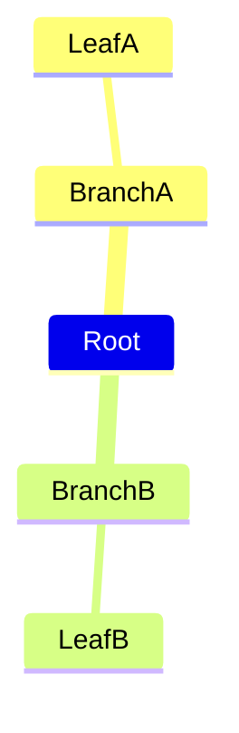

# Concrete Mermaid 12.2 authored-semantics gap — 2026-10-23

Read-only followup; no product changes/commits. Reference checkout: `/mnt/data/Projects/mermaid`, `6d8921f94f9a12b76586eddcf45a566080d4767e`, package version 12.2.0. Native: published MIT Merman 0.9.2, declared Mermaid 12.1.0 target. This report excludes the already documented font/geometry differences.

## Released 12.2: one confirmed silent semantic omission

`packages/mermaid/CHANGELOG.md:3–27` lists **one new minor feature**, `mindmap.colorBy: depth`; the remaining entries are rendering/layout fixes. No newly added diagram family is identified by these release notes. The local git checkout is shallow (one commit, no release tags or earlier feature commit objects), so a true local 12.1→12.2 git diff is unavailable; do not claim this proves all undocumented differences are exhausted.

Official pointer: [PR #8394](https://github.com/mermaid-js/mermaid/pull/8394), authored change `6ac38cb4441f67a29336cb3039c1a63e7a87d969`. Local source/spec:

- `packages/mermaid/src/docs/syntax/mindmap.md:113–175`: explicitly marks depth coloring **v12.2.0+**.
- `packages/mermaid/src/schemas/config.schema.yaml:1219–1228`: `colorBy` enum `branch|depth`, default `branch`.
- `packages/mermaid/src/diagrams/mindmap/mindmapDb.ts:197–216,377`: root section undefined; depth mode non-root section `(depth - 1) % 11`; depth is actual parent-child distance, not indentation columns. Edge section follows its child.
- `.../mindmap/mindmapColors.spec.ts:29–98`: reference coverage for uneven indentation, branch vs depth, inserting a preceding branch, and palette wrap after eleven levels.

Minimal authored source, rendered successfully by both public engines:



Observed node section classes, source order `Root, BranchA, LeafA, BranchB, LeafB`:

| Configuration | Original released 12.2 | Native Merman 0.9.2 |
|---|---|---|
| `branch` | root, 0, 0, 1, 1 | root, 0, 0, 1, 1 |
| `depth` | root, 0, 1, 0, 1 | **root, 0, 0, 1, 1** |

Native accepts the frontmatter, returns success without an unsupported-option diagnostic, but **silently ignores the requested depth semantics**. This is not a text-metric or pixel-parity issue.

## Minimum pre-layout repair; public config adapter is insufficient

Cached crate prefix is `/home/kb/.asdf/installs/rust/1.99.0/registry/src/index.crates.io-1949cf8c6b5b557f/`.

Concrete patch points in `merman-core-0.9.2`:

1. `src/diagrams/mindmap/parse.rs:110`: read `/mindmap/colorBy` from `meta.effective_config` and pass a branch/depth policy into section assignment, before creating typed nodes/edges at lines112–114.
2. `src/diagrams/mindmap/db.rs:303–342`: retain iterative/cancellable traversal but carry **structural depth** in its work stack. Preserve the existing branch path exactly. In depth mode, assign non-root section `((depth - 1) % 11)`, retaining root `None` and the eleven-slot palette. Do not use the indentation-based `level` as depth.
3. Existing node/edge projections (`db.rs:78–81,115,121–122,144`) already derive `section-*` / `section-edge-*` from these semantics. Existing `merman-render-0.9.2/src/svg/parity/mindmap/render.rs:420–499` maps section classes to `cScale*`, `cScaleLabel*` and edge stroke colors. A correct core change therefore flows through layout and SVG normally; no post-hoc SVG recoloring or renderer rewrite is required.

Estimated production change: **roughly 20–35 changed lines across these two core files**, plus about 60–100 lines of focused tests. Estimate, not an implemented/verified patch. Preserve `OperationControl` checkpoints and finite resource policies. Cover default/explicit branch, uneven indentation, multiple branches, preceding sibling insertion, >11 levels, user classes/icons and child edge color correspondence. Test through the public wrapper as well as typed semantic output.

**No existing public config/semantic-transform hook can perform this coherently before built-in layout:** the config is currently never read at the patch point; changing theme palette defaults cannot turn a branch partition into a depth partition. `merman-0.9.2/src/operation.rs:179–227` exposes an immutable `SemanticArtifact`, not a typed-model mapper. `merman-core/src/diagram/mod.rs:93–101,1211–1214` limits custom render-parser overlays to `CustomJsonRenderModel`; it deliberately cannot manufacture the built-in Mindmap variant. `ParsedDiagramRender` cannot be reconstructed externally (`:1266–1305`), and `merman-render/src/family.rs:1598–1624` requires that canonical pair. Reading/modifying a compatibility JSON copy does not modify the consumed built-in model.

Recommended implementation route: a **tiny audited patch to the exact published `merman-core` baseline**, with tests and preserved MIT provenance, keeping other Merman crates at 0.9.2. A narrowly pinned patched upstream/fork dependency avoids checking in the whole backend; only the core crate needs modification. If a local dependency is preferred, core's extracted crate is ~6.8 MiB; do not vendor the entire Merman workspace merely for this option. Adding a general typed-model mutation API is a larger architectural change than this direct fix. No claim is made that an unexamined newer release/main already fixes it.

Until repaired, expose a specific unsupported-option diagnostic or reject `mindmap.colorBy: depth`; successful silent branch rendering is misleading. Source detection must read effective parsed config, not a global text substring.

## Pending checkout changes are not released-12.2 gaps

The checkout contains two unconsumed `.changeset` files beyond the release notes:

- `.changeset/agentflow-short-input-form.md`: input shorthand `a[/Short/]` instead of `a["Meta"]@{ shape: input }`. Local authored test `packages/mermaid/src/diagrams/agentflow/agentflow-shape-catalogue.spec.ts:129–149`. **Already supported by the selected native engine:** both nodes emit `af-kind-input`; Merman `src/diagrams/agentflow.rs:1638` handles both `lean-right` and parser spelling `lean_right`. The existing released-12.2 oracle also emits input kinds for both. No adapter work demonstrated necessary.
- `.changeset/three-ads-care.md`: edge IDs without whitespace after node shapes, plus exclusion of `[ ] ( ) { } |` from IDs. Probe `A[Start] edge1@--> B[Done]` succeeds in both native and released-12.2 oracle; `A[Start]edge1@-->B[Done]` fails in **both**. Thus the tight form is a **pending checkout extension**, not a demonstrated released-12.2 regression. If exact current checkout compatibility is desired later, fix the flowchart grammar/lexer; do not globally insert whitespace into source (labels/metadata/strings can contain these characters). This is separate from the official depth-color fix.

No new family implementation is justified by this bounded release-delta check. Existing admitted extensions such as agentflow/usecase/tree are not newly introduced in the 12.2 release notes, and must not inflate the reported release-gap count.

## Executable evidence and temporary artifacts

Inputs: `/tmp/ive-mermaid-12.2-probe/input/` (5 tiny cases). Native harness uses public `diagram_engine::render` with default limits, no product changes: `/tmp/ive-mermaid-font-probe/src/bin/version_gaps.rs`.

```sh
cargo run --offline --manifest-path /tmp/ive-mermaid-font-probe/Cargo.toml --bin version_gaps
# 4 rendered, 1 parse error (only whitespace-free edge ID).
cd /tmp/ive-diagram-oracles.JwN5H5
node oracles.mjs --corpus /tmp/ive-mermaid-12.2-probe/input
# Released Mermaid12.2: also4 rendered, same1 parse error.
```

SVG/semantic-class evidence is isolated at `/tmp/ive-mermaid-12.2-probe/{native,original}/`. Both branch/depth inputs have the same topology; native SVG classes demonstrate ignored semantics without relying on visual judgment.

Oracle artifact handling caveat: existing `oracles.mjs --corpus` has a fixed output folder and **ignores an output argument**. Its five-case manifest briefly replaced the temporary baseline admission manifest. New probe files were moved into the isolated `original/` folder, and the baseline was regenerated from the exact product37 fixtures. Verified: exactly37 `.mmd` files,37/37 source SHA-256 hashes agree with untouched `native-comparison.json`,36 original accepts/ZenUML needs plugin.33/36 regenerated SVG hashes equal the historical baseline; architecture/gantt/git differ on rerender (same source/config; architecture bounds unchanged, Gantt bounds width changes1px, git bounds/viewBox height changes). Their historical raw SVG bytes were not recovered. The prior comparison JSON/report remain untouched historical evidence; do not claim all36 regenerated SVGs are byte-identical. This investigation wrote only temporary probe/oracle artifacts, not product files.
